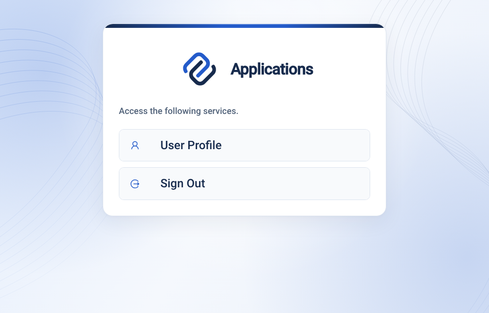
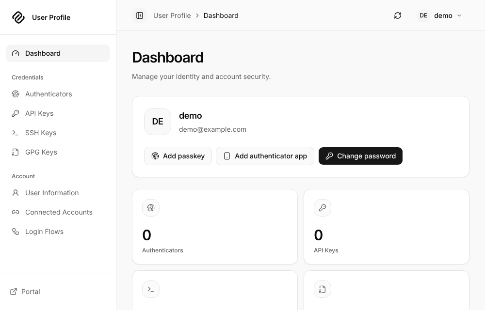
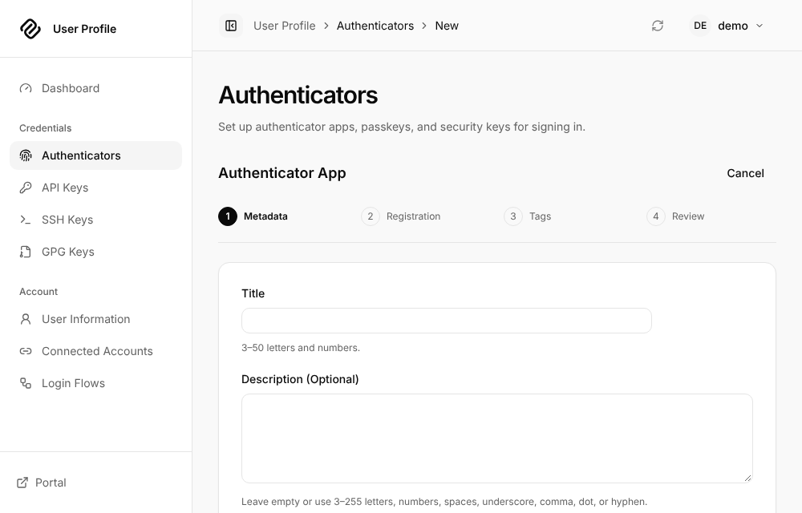
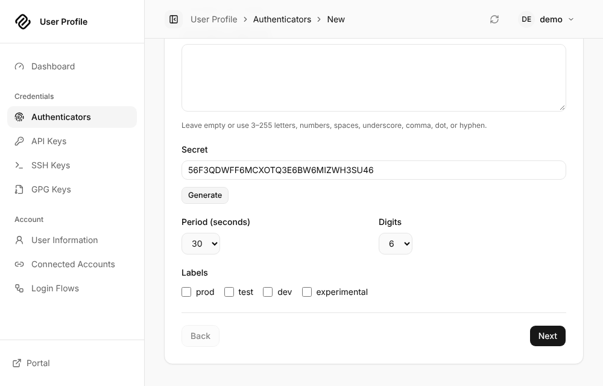
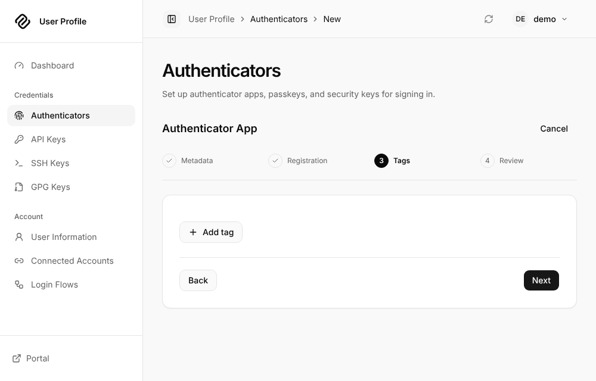
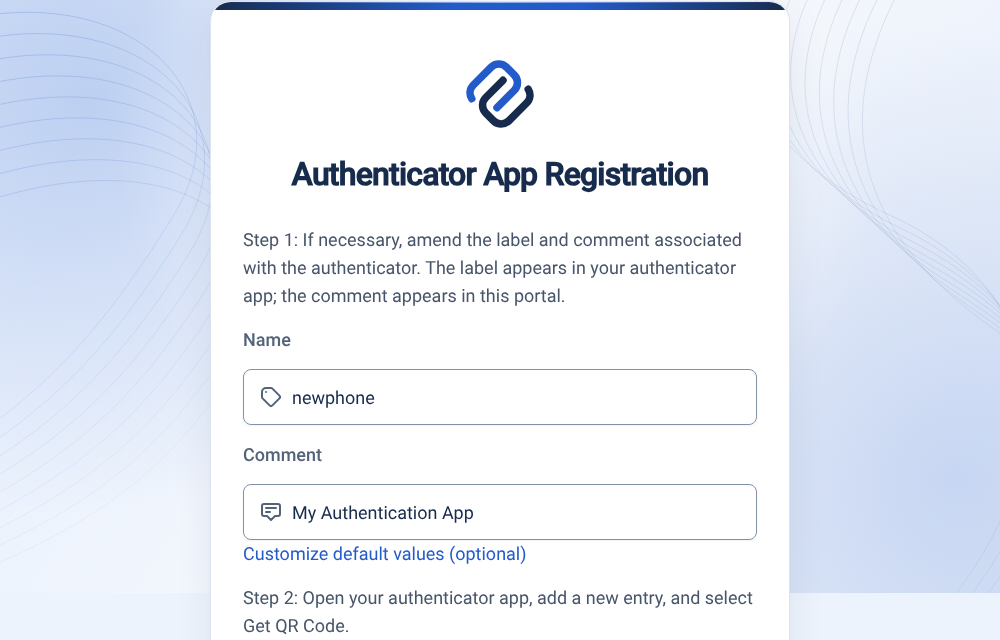

# caddy-security 構築・動作確認手順書

Caddy 用認証プラグイン [caddy-security](https://github.com/greenpau/caddy-security) を、ビルド → 認証ポータル起動 → パスワード認証 → パスワード変更 → 多要素認証(TOTP) → ロックアウト復旧の順に確認した記録です。

- 確認日: 2026-11-21
- 環境: Linux (cloud container) / Go 1.24.7 / Caddy v2.11.9 / Playwright (Chromium)
- 作業ディレクトリ: スクラッチパッド `.../scratchpad/cs/`(バイナリ・設定・`users.json`)、`.../scratchpad/otp/`(MFA 検証用スクリプト)
- すべて **ローカル(HTTP, :8080)での検証用構成**です。本番利用時は「11. 本番化の注意」を必ず確認してください。

---

## 1. 結論(サマリ)

| 項目 | 結果 |
|---|---|
| xcaddy で caddy-security 入りの Caddy をビルド | 成功(`caddy list-modules` に `security` が出る) |
| 認証ポータル+認可ポリシーの起動 | 成功 |
| 未認証アクセス | 302 でログイン画面へ |
| パスワード認証 | 正しいPW: `/app` に到達(200) / 誤PW: 401 |
| 初期パスワードの変更 | プロフィール画面から変更可。旧PWは無効、新PWで通過 |
| TOTP(認証アプリ)登録とログイン | 成功。コードなし・誤コードは拒否 |
| 認証アプリ紛失時の復旧 | `users.json` の `mfa_tokens` を空にして復旧できた |
| MFA 必須化(`require mfa`)と新規ユーザー | 検証済み。パスワード後に強制登録画面へ誘導され、登録するまで入れない |
| 必須化中の紛失復旧 | `mfa_tokens` を空にすると強制登録画面に戻り、再登録で復旧 |
| ログイン後のアプリ選択(ポータルのメニュー) | 検証済み。`ui link` で表示、ロールで出し分け(管理者のみ確認) |
| 別の管理者が UI から他ユーザーの MFA を解除 | **未確認**(管理用 UI は見当たらず) |

---

## 2. ビルド

```bash
# xcaddy の取得
GOBIN=$PWD go install github.com/caddyserver/xcaddy/cmd/xcaddy@latest

# caddy-security 入りの Caddy をビルド
./xcaddy build --with github.com/greenpau/caddy-security --output ./caddy

# 確認
./caddy version                       # v2.11.9
./caddy list-modules | grep -i security   # security が出ればOK
```

所要は約1分(依存ダウンロード込み)。

---

## 3. 設定(Caddyfile)

```caddyfile
{
	admin off
	order authenticate before respond
	order authorize before basicauth
	security {
		local identity store localdb {
			realm local
			path /path/to/users.json
		}
		authentication portal myportal {
			crypto default token lifetime 3600
			crypto key sign-verify <ランダムな鍵(UUID等)>
			enable identity store localdb
			cookie insecure on        # ← HTTP検証用。HTTPS運用では削除
		}
		authorization policy mypolicy {
			set auth url /auth/
			crypto key verify <上と同じ鍵>
			allow roles authp/user authp/admin
		}
	}
}
:8080 {
	route /auth* {
		authenticate with myportal
	}
	route /app* {
		authorize with mypolicy
		respond "protected OK" 200
	}
}
```

### ハマりどころ

- `route /auth* { authenticate with myportal }` のような **1行ブロックは Caddyfile のパースエラー**になる(`Unexpected next token after '{' on same line`)。必ず改行して書く。
- 検証コマンド: `./caddy validate --config Caddyfile --adapter caddyfile`

---

## 4. 起動と初期ユーザー

初回起動時に、環境変数で管理者ユーザーを `users.json` に作成できる。

```bash
export AUTHP_ADMIN_USER=testuser
export AUTHP_ADMIN_EMAIL=test@example.com
export AUTHP_ADMIN_SECRET='<初期パスワード>'
./caddy run --config Caddyfile --adapter caddyfile
```

- 作成されるロールは `authp/admin`。
- 既にユーザーが存在する場合、後から `AUTHP_ADMIN_SECRET` を変えても反映されない(想定。確認は未実施)。
- パスワードの再設定は次章のとおりプロフィール画面で行う。

---

## 5. パスワード認証の動作確認

| ケース | 結果 |
|---|---|
| 未認証で `/app` | 302 → `/auth/?redirect_url=...` |
| `/auth/login` | 200(ログイン画面) |
| 誤パスワード | 401(ログに `password authentication failed`) |
| 正しいパスワード | `/auth/portal` に着地し `AUTHP_ACCESS_TOKEN` Cookie 発行。その Cookie 付きで `/app` が 200「protected OK」 |

### ログインフローは2段階

1. `/auth/login` にユーザー名(`username`)と `realm=local` を送る
2. sandbox 画面(`/auth/sandbox/<id>/`)にパスワードを `secret` フィールドで送る(`sandbox_id` も必要)

curl でログインを再現する場合は上記に従う(JSON で `password` を送ると `unknown field "password"` で 400)。ブラウザなら画面どおりに操作すれば通る。

### 画面イメージ

**① 未認証で `/app` に入ると、ログイン画面(ユーザー名またはメール)へ飛ばされる**


**② ユーザー名を入れて Proceed を押すと、パスワード画面になる**


**③ 誤ったパスワードは 401。「Authentication Failed」が出て、`/app` には入れない**


**④ 正しいパスワードで認証後のポータル(`/auth/portal`)**



**⑤ 認証後は保護対象の `/app` が表示される(「protected OK」)**


---

## 6. パスワード変更(初期パスワードからの変更)

ユーザー本人が UI から変更できる。

1. `/auth/` にログイン → `/auth/profile/` を開く
2. Dashboard の **Change password** を押す
3. 「現在のパスワード」「新しいパスワード」「新しいパスワード(確認)」の3欄を入力して保存
   - 新パスワードは 8〜254 文字、2回分が一致していること
4. 「Completed successfully」が表示されれば完了

### 画面イメージ

**① `/auth/profile/` の Dashboard。ユーザー情報と「Change password」ボタンがある**



**② 「Change password」を押すと、3つの入力欄のダイアログが開く**


**③ 現在のパスワードと、新しいパスワード(2回)を入力する**


**④ 「Completed successfully.」が出れば完了**


検証結果: 変更後、旧パスワードではパスワード画面から先へ進めず、新パスワードで `/app` に到達した。

補足:
- `users.json` には世代管理されたハッシュ(bcrypt)が残り、旧PWは `expired` / `disabled` になる。
- パスワードポリシー(`users.json` の `policy.password`)は既定で最小8文字、大文字・数字・記号の要件なし。必要なら強化する。

---

## 7. 多要素認証(TOTP / 認証アプリ)

### 7.1 概要

- 「Add authenticator app」は Google Authenticator などの **TOTP(RFC 6238)** 対応アプリを2段階認証として登録する機能。
- **Google Authenticator の料金(2026-11-21 時点の調査)**
  - 利用者側は**無料**。Apple App Store の掲載は「Free」(価格表示で確認)。Android(Google Play)は掲載ページそのものは確認できておらず、二次情報(Gizmodo の案内)で無料とされている。
  - 有料プランやアプリ内課金は見つからなかった。「個人利用は無料、業務利用は有料」といった**区別も確認できなかった**(業務で全員に使わせる場合は、アプリストアの掲載と利用規約を最終確認のこと)。
  - Google アカウントでのログインは任意。ログインするとコードが端末間で同期され(Android 6.0 以上 / iOS 4.0 以上)、ログインしない場合は「Transfer codes → Export codes」の QR で新端末へ移せる。オフラインでもコードは生成できる。
  - **名前の似た別アプリに注意**: 「Authenticator」を名乗るサードパーティ製アプリには、アプリ内課金のある有料版がある。公式の Google Authenticator とは別物なので、提供元(Google LLC)を確認してからインストールする。
  - 参考: [Get verification codes with Google Authenticator(Google アカウント ヘルプ)](https://support.google.com/accounts/answer/1066447) / [App Store の Google Authenticator](https://apps.apple.com/us/app/google-authenticator/id388497605)
- Microsoft Authenticator / Authy / Aegis / 2FAS なども利用可(TOTP 対応なら何でも可)。
- サーバー側は、TOTP が公開規格(RFC 6238)で、caddy-security もオープンソースのため、この機能に追加の費用はかからない。
- 「Add passkey」は WebAuthn / U2F(指紋・顔認証、YubiKey 等)で、別方式。

### 7.2 登録手順(UI)

`/auth/profile/` → Dashboard の **Add authenticator app**(または `/auth/profile/multi-factor-authenticators/mfa-app/new`)

1. **Metadata**: Title(3〜50文字の英数字)を入力、**Generate** で秘密鍵を生成。Period(30/60/90秒)・Digits(4/6/8)は既定のままで可
2. **Registration**: QR コードを認証アプリで読み取り、表示された6桁コードを入力して **Verify**(「Completed successfully」が出る)
3. **Tags**: 任意
4. **Review**: **Create**

登録完了後、再ログインを求められる。

### 画面イメージ(登録ウィザード)

**① Step 1 Metadata。Title と Secret を入れる画面**



**② Title を入力し、Generate で秘密鍵を生成する**



**③ Step 2 Registration。QR コードを認証アプリで読み取り、6桁コードを入力して Verify**


**④ 「Completed successfully.」が出れば検証OK。Next へ**


**⑤ Step 3 Tags(任意)**



**⑥ Step 4 Review。Status が Verified であることを確認して Create**


**⑦ 登録後は再ログインを求められる**


### 7.3 Playwright で自動化する場合の注意

- 画面に表示される secret 文字列は、**ASCII 文字列を Base32 化した値**が実際の TOTP 鍵になる(QR の otpauth URI の `secret=` がその値)。コード生成側(otplib など)にはこの変換後の値を渡すこと。表示文字列をそのまま鍵にすると「Unable to complete this request」で Verify に失敗する。
- 入力欄は `type` 属性なしの `<input>` のため、`input[type=text]` セレクタでは見つからない。`input:not([type=checkbox]):not([type=hidden]):not([type=radio])` などを使う。
- `playwright` / `otplib` は `NODE_PATH=$(npm root -g)` と `npm i otplib@12.0.1` で解決した。

### 7.4 MFA 有効時のログイン挙動

| 操作 | 結果 |
|---|---|
| パスワード後、コードを入力せず `/app` へ | 入れない(Sign In 画面) |
| 誤ったコード | 「Your session failed to meet authorization requirements」で拒否 |
| 正しい TOTP コード | `/auth/portal` に着地し `/app` が 200 |

パスワード認証後に「Authenticator App / Passcode / Verify」画面が出て、そこで6桁コードを入力する。

### 画面イメージ

**① パスワード認証後、「Authenticator App / Passcode」画面で6桁コードを入力する**


**② 誤ったコードは拒否される**


**③ 正しいコードでポータルに入れる**


**④ `/app` が「protected OK」**


**⑤ 登録後のプロフィール。Authenticators が 1 になる**


### 7.5 MFA の保存場所

`users.json` の `users[].mfa_tokens[]` に保存される(`type: totp`, `algorithm: sha1`, `period`, `digits`, `secret` など)。

---

## 8. ロックアウト対策と復旧

### 8.1 事前の備え(推奨)

1. 認証アプリを**複数端末**に登録する(同じ QR を複数回読める)
2. 登録時の秘密鍵(テキスト)を安全な場所に控える
3. Google Authenticator のクラウド同期をオンにする
4. Passkey / 物理キーを併用登録する
5. 管理者を**2人以上**にする
6. 非常用(break-glass)管理者アカウントを作り、強いパスワードを金庫に保管する(普段は使わない)
7. `users.json` を定期バックアップする

### 8.2 復旧手順(認証アプリを失くした場合)

**検証済み**。サーバー上で `users.json` を編集する。

```bash
# 1. Caddy を停止する(稼働中に編集すると Caddy が上書きするおそれ)
pkill caddy

# 2. バックアップ
cp users.json users.json.bak

# 3. 対象ユーザーの mfa_tokens を空にする
python3 - <<'EOF'
import json
f = 'users.json'
d = json.load(open(f))
for u in d['users']:
    if u['username'] == 'testuser':      # ← 対象ユーザー名
        u['mfa_tokens'] = []
json.dump(d, open(f, 'w'), indent=2)
EOF

# 4. Caddy を起動し、パスワードのみでログインできることを確認
./caddy run --config Caddyfile --adapter caddyfile
```

復旧後、本人が認証アプリを再登録する。

MFA を**必須化している場合**は、`mfa_tokens` を空にしたあとの最初のログインで、パスワードだけで入れるのではなく**強制登録画面**(9章)に進む。本人が認証アプリを再登録するまで保護対象には入れない(検証済み)。

### 8.3 未確認事項

- 別の管理者が UI から他ユーザーの MFA 登録を解除できるか(ポータルのナビに「Users」等の管理画面は見当たらなかった)
- 管理者が複数いる場合の復旧フロー(今回は管理者1人の環境のみ)
- MFA の連続失敗によるロックアウトの閾値・解除方法(ソース上は `account temporarily locked due to too many failed MFA attempts` が存在するが、動作は未確認)

---

## 9. MFA の必須化

### 9.1 設定

ポータルに `transform user` を追加する。

```caddyfile
authentication portal myportal {
	...
	transform user {
		match any        # 全員に適用(条件で絞ることも可)
		require mfa      # password / mfa / totp / u2f が指定可
	}
}
```

- `mfa` は認証アプリ・パスキーのどちらでも可、`totp` は認証アプリ限定、`u2f` はパスキー限定。
- `require auth challenges <method>...` の書式もある。

### 9.2 新規ユーザー(MFA 未登録)の挙動【検証済み】

1. ユーザー名 → パスワードの認証は通る。
2. その直後に「Your session requires multi-factor authentication. However, you do not have a second factor authentication method configured.」という**登録画面**が出る(選択肢: Authenticator App / Hardware Token)。
3. 登録を終えるまで `/app` など保護対象には入れず、ログイン画面に戻される。
4. 登録後は、毎回「パスワード → 6桁コード」が必要になる。

### 画面イメージ(強制登録)

**① パスワード認証の直後に出る登録画面。Authenticator App か Hardware Token を選ぶ**


**② Authenticator App を選ぶと、ラベル・コメントの入力画面(Step 1)**


**③ 「Get QR Code」で QR が出る。認証アプリで読み取り、6桁コードを入力して登録する**



**④ 登録直後は「Unauthorized」と出るが、登録は保存されている。再ログイン後はコード認証に進む**


| 状況 | 結果 |
|---|---|
| MFA 未登録でパスワードのみ | 強制登録画面。`/app` には入れない |
| 登録後・コードなし | `/app` に入れない |
| 登録後・誤コード | 「Your session failed to meet authorization requirements」で拒否 |
| 登録後・正しいコード | `/app` が「protected OK」 |
| `mfa_tokens` を空にしたあと(8.2) | 再び強制登録画面に戻る |

### 9.3 強制登録画面の仕様(自動化する場合の注意)

- 登録 URL は `/auth/sandbox/<id>/mfa-app-register`。入力項目は `label` / `comment` / `secret` / `passcode` など。
- **Get QR Code** を押すと、QR 画像の URL(`/auth/sandbox/<id>/mfa-app-barcode/<Base64>`)の末尾に otpauth URI が Base64 で入る。ここから `secret=` を取り出せば、実際の TOTP 鍵になる。
- `passcode` 入力欄は画面上は非表示(`isVisible=false`)のため、Playwright の `fill` はタイムアウトする。値を直接設定してフォームを `requestSubmit()` した。
- 登録の POST 直後の応答は 401「Unauthorized」だったが、`users.json` には TOTP が保存されており、再ログインで正常にコード認証できた(UI 上の見え方が不親切なだけで、登録は成功している)。
- ログイン中の MFA チェックポイントで追加登録できるのは、要素が1つも無いアカウントだけ(ソースコメントより)。すでに登録済みだと「verify an existing MFA factor before adding another」で拒否される。登録後の追加は、ログイン済みの `/auth/profile/` から行う。

### 9.4 運用上の注意

- 既存の管理者も、次回ログインで MFA 未登録なら強制登録画面に誘導される。**必須化の前に、管理者の認証アプリ(できれば2台)を登録しておく**。
- 認証アプリを紛失した場合は 8.2 の復旧後、強制登録画面から再登録する。
- 検証で `caddy validate` を環境変数なしで実行すると、その時点で `users.json` が既定ユーザー(`webadmin`)で作られる。初期ユーザーを `AUTHP_ADMIN_*` で作りたい場合は、**環境変数を設定した状態で最初に起動する**こと(検証ミスで一度発生)。

---

## 10. ログイン後に飛べるアプリの選択(ポータルのメニュー)

ログイン後のポータル(`/auth/portal`)に、アプリへのリンク(メニュー)を並べられる。ユーザーの属性(ロール等)ごとに出し分けも可能。

### 10.1 設定(`transform user` の `ui link`)

```caddyfile
authentication portal myportal {
	...
	transform user {
		match realm local                       # ローカルDBの全ユーザー
		ui link "Wiki" /wiki/ icon "las la-book"
		ui link "Dashboard" /dash/ icon "las la-chart-line"
	}
	transform user {
		match role authp/admin                  # 管理者だけに出す
		ui link "Admin Console" /admin/ icon "las la-cog"
	}
	transform user {
		match role authp/user                   # 一般ユーザーだけに出す
		ui link "User-only App" /useronly/ icon "las la-user"
	}
}
```

- 書式: `ui link <title> <url> [icon <class>] [target_blank]`。`icon` は Line Awesome のクラス名。`target_blank` を付けると別タブで開く。
- `<url>` は同じ Caddy 上のパスでも、外部 URL でもよい。
- `match` の条件(ロールなど)に合うユーザーにだけ、そのリンクが出る。

### 10.2 検証結果(管理者 `demo` でログイン)


| 項目 | 結果 |
|---|---|
| 表示されたリンク | Wiki / Dashboard / Admin Console(+ 標準の User Profile / Sign Out) |
| 表示されなかったリンク | User-only App(`authp/user` のみ対象のため、管理者には出ない) |
| リンクをクリック | `/wiki/` に遷移し、保護ページが表示された(認証済みなので 200) |

ロールによる出し分けは、管理者での表示結果(Admin Console は出る、User-only App は出ない)で確認した。

### 10.3 重要な注意: メニューは「見せるかどうか」だけ

- `ui link` は**メニューの表示**を制御するだけで、アクセス制御ではない。リンクを出さなくても、URL を直接開けば到達できる。
- 実際に守るのは `authorize with <policy>` と、その `allow roles ...` の設定。たとえば管理者専用アプリには `allow roles authp/admin` のポリシーを別に用意して使う(上の検証では `adminonly` ポリシーを `/admin*` に適用)。
- 検証は管理者アカウントのみ。**一般ユーザー(`authp/user`)でのメニュー表示と、`/admin/` が拒否されること**は、この環境では未確認。

## 11. 本番化の注意

- `cookie insecure on` は HTTP 検証用。**HTTPS 運用では削除**する。
- `crypto key sign-verify` / `crypto key verify` の鍵は検証用の値を使い回さず、ランダムに生成して安全に保管する。
- `AUTHP_ADMIN_*` 環境変数は**初回の管理者作成だけ**に使い、その後は環境から外す。
- 初期パスワードは初回ログイン後に必ず変更する。
- `users.json` は認証情報(ハッシュ・MFA 秘密鍵)を含むため、権限(例: 600)とバックアップの保管場所に注意する。
- `admin off` は検証用。運用方針に合わせて見直す。

---

## 12. 検証で使ったもの(参考)

| 項目 | 内容 |
|---|---|
| ポート | `:8080`(`/auth*` がポータル、`/app*` が保護対象) |
| テストユーザー | `testuser`(検証用。値は本書に記載しない。本番で使わない) |
| 主なスクリプト | `pw2.js`(パスワード変更)、`reg5.js`(TOTP登録)、`login.js`(MFAログイン確認)、`req1.js`〜`req3.js` / `login3.js`(MFA必須化の検証) |
| 取得した画像 | プロフィール、パスワード変更ダイアログ、MFA 登録の各画面(スクラッチパッド内) |

> 画面イメージは `images/` に格納している(1000×640、検証用ユーザー `demo` / `newuser` の画面)。QR コードは検証環境限りの使い捨ての鍵で、本番では使っていない。検証スクリプトは一時ディレクトリ(スクラッチパッド)にあり、このリポジトリには含まれていない。
