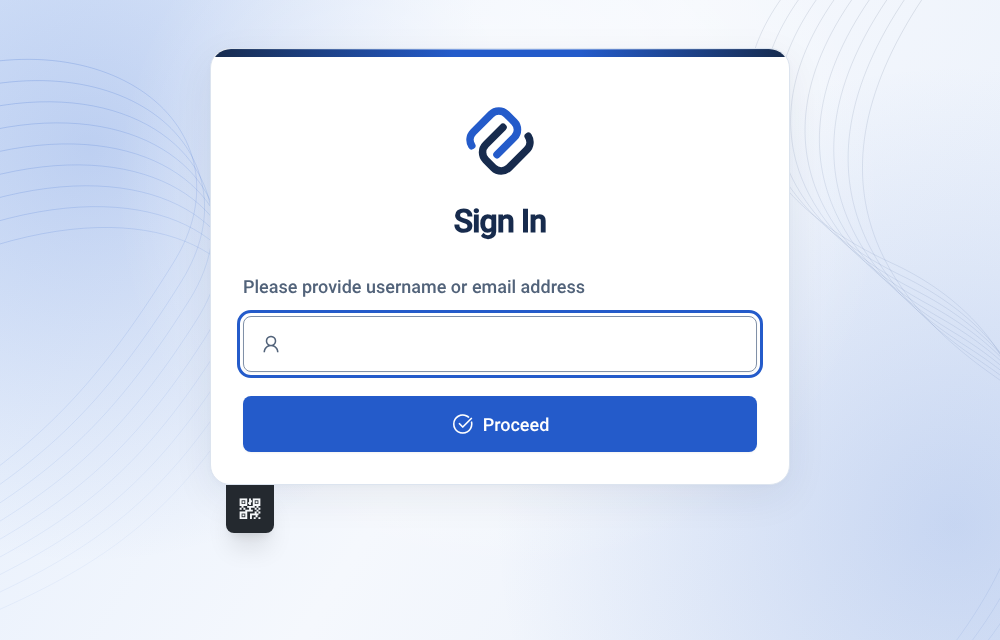
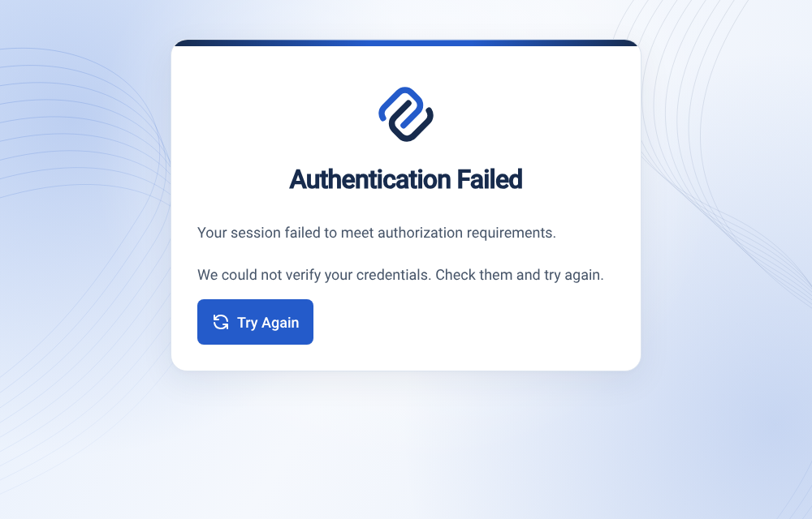
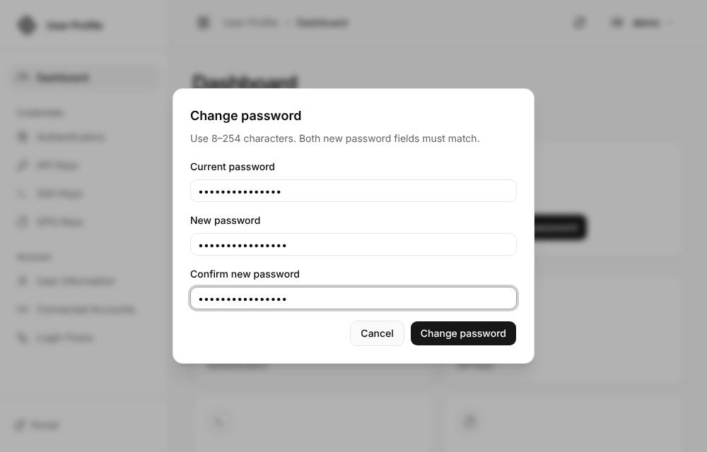
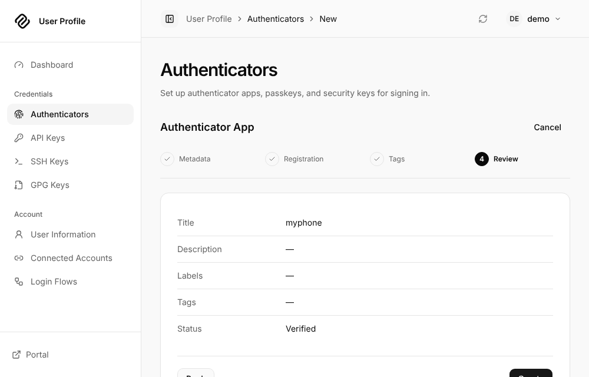
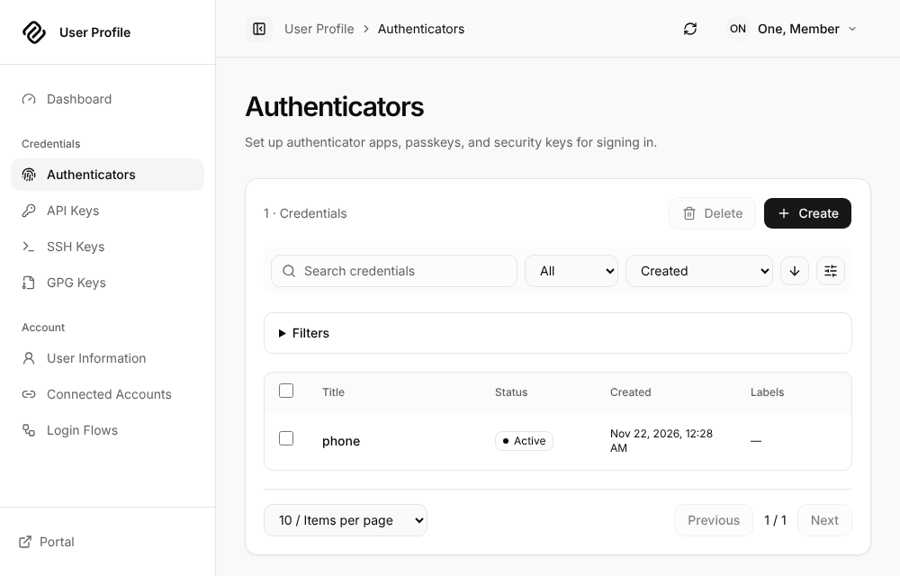
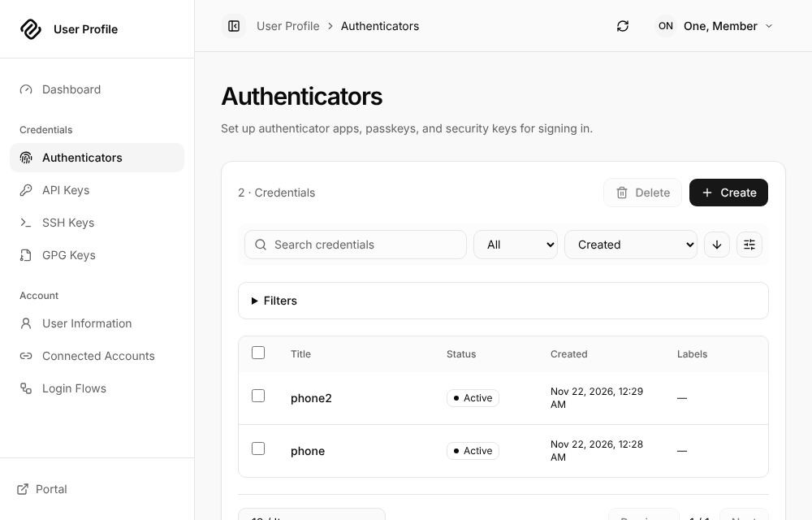
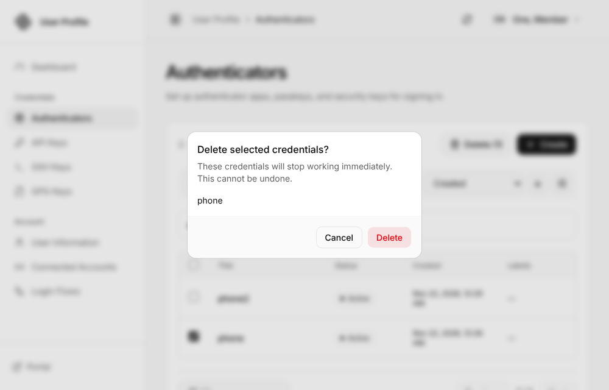
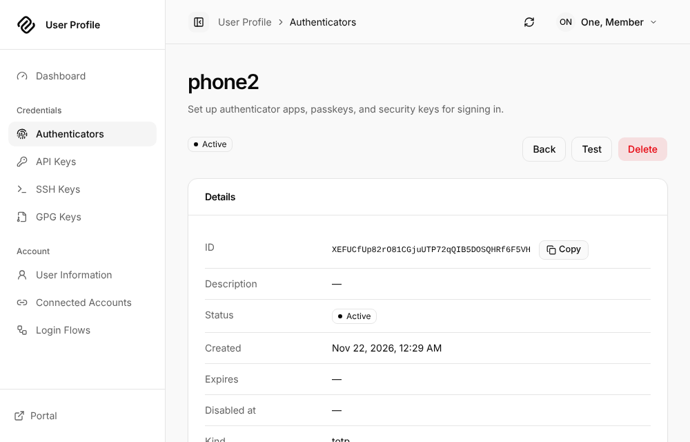

# caddy-security 構築・動作確認手順書

Caddy 用認証プラグイン [caddy-security](https://github.com/greenpau/caddy-security) を、ビルド → 認証ポータル起動 → パスワード認証 → パスワード変更 → 多要素認証(TOTP) → ロックアウト復旧の順に確認した記録です。

- 確認日: 2026-11-21
- 環境: Linux (cloud container) / Go 1.24.7 / Caddy v2.11.9 / Playwright (Chromium)
- 作業ディレクトリ: スクラッチパッド `.../scratchpad/cs/`(バイナリ・設定・`users.json`)、`.../scratchpad/otp/`(MFA 検証用スクリプト)
- すべて **ローカル(HTTP, :8080)での検証用構成**です。本番利用時は「12. 本番化の注意」を必ず確認してください。

---

## 1. 結論(サマリ)

| 項目 | 結果 |
|---|---|
| xcaddy で caddy-security 入りの Caddy をビルド | 成功(`caddy list-modules` に `security` が出る) |
| 認証ポータル+認可ポリシーの起動 | 成功 |
| 未認証アクセス | 302 でログイン画面へ |
| パスワード認証 | 正しいPW: `/app` に到達(200) / 誤PW: 401 |
| 初期パスワードの変更 | プロフィール画面から変更可。旧PWは無効、新PWで通過 |
| TOTP(認証アプリ)登録とログイン | 成功。コードなし・誤コードは拒否 |
| 認証アプリ紛失時の復旧 | `users.json` の `mfa_tokens` を空にして復旧できた |
| MFA 必須化(`require mfa`)と新規ユーザー | 検証済み。パスワード後に強制登録画面へ誘導され、登録するまで入れない |
| 必須化中の紛失復旧 | `mfa_tokens` を空にすると強制登録画面に戻り、再登録で復旧 |
| ログイン後のアプリ選択(ポータルのメニュー) | 検証済み。`ui link` で表示、ロールで出し分け(管理者・一般ユーザーの両方で確認) |
| CLI でのリセット権限 | 検証済み(4.7)。管理者ロール(`authp/admin`)の認証情報が必要。ロール付与は `--roles` / `--add-roles`。剥奪前のトークンは期限まで有効 |
| 管理者自身・他の管理者・MFA 付きアカウントのリセット | 検証済み(4.5)。いずれもリセット可能で、MFA は残り回避されない |
| 一般ユーザーの追加 | 検証済み。管理 API + `caddy security local add user`。初期パスワードは自動生成され、管理者の画面にだけ出る |
| 初回ログイン時のパスワード変更の強制 | **確認できず**(生成パスワードのまま入れた) |
| 別の管理者が UI から他ユーザーの MFA を解除 | **未確認**(管理用 UI は見当たらず) |

---

## 2. ビルド

```bash
# xcaddy の取得
GOBIN=$PWD go install github.com/caddyserver/xcaddy/cmd/xcaddy@latest

# caddy-security 入りの Caddy をビルド
./xcaddy build --with github.com/greenpau/caddy-security --output ./caddy

# 確認
./caddy version                       # v2.11.9
./caddy list-modules | grep -i security   # security が出ればOK
```

所要は約1分(依存ダウンロード込み)。

---

## 3. 設定(Caddyfile)

```caddyfile
{
	admin off
	order authenticate before respond
	order authorize before basicauth
	security {
		local identity store localdb {
			realm local
			path /path/to/users.json
		}
		authentication portal myportal {
			crypto default token lifetime 3600
			crypto key sign-verify <ランダムな鍵(UUID等)>
			enable identity store localdb
			cookie insecure on        # ← HTTP検証用。HTTPS運用では削除
		}
		authorization policy mypolicy {
			set auth url /auth/
			crypto key verify <上と同じ鍵>
			allow roles authp/user authp/admin
		}
	}
}
:8080 {
	route /auth* {
		authenticate with myportal
	}
	route /app* {
		authorize with mypolicy
		respond "protected OK" 200
	}
}
```

### ハマりどころ

- `route /auth* { authenticate with myportal }` のような **1行ブロックは Caddyfile のパースエラー**になる(`Unexpected next token after '{' on same line`)。必ず改行して書く。
- 検証コマンド: `./caddy validate --config Caddyfile --adapter caddyfile`

---

## 4. 起動と初期ユーザー

初回起動時に、環境変数で管理者ユーザーを `users.json` に作成できる。

```bash
export AUTHP_ADMIN_USER=testuser
export AUTHP_ADMIN_EMAIL=test@example.com
export AUTHP_ADMIN_SECRET='<初期パスワード>'
./caddy run --config Caddyfile --adapter caddyfile
```

- 作成されるロールは `authp/admin`。
- 既にユーザーが存在する場合、後から `AUTHP_ADMIN_SECRET` を変えても反映されない(想定。確認は未実施)。
- パスワードの再設定は次章のとおりプロフィール画面で行う。

### 4.2 ユーザーの追加(管理 API + CLI)【検証済み】

環境変数で作れるのは最初の管理者だけ。2人目以降は、管理 API を有効にして `caddy security local` で追加する。

**① ポータルで管理 API を有効にする**

```caddyfile
authentication portal myportal {
	...
	enable admin api
}
```

**② 管理者のクライアント設定(YAML)を用意する**(Caddyfile とは別ファイル。管理者のパスワードを含むので権限 600 にする)

```yaml
base_url: http://localhost:8080/auth
username: <管理者のユーザー名>
realm: local
password: <管理者のパスワード>
```

**③ ユーザーを追加する**

```bash
./caddy security local add user --config client.yaml --realm local \
  --username member1 --email member1@example.com --name "Member One" \
  --roles authp/user
```

出力は JSON で、**自動生成された初期パスワード**が `"password"` に入って返る(下の 4.3 参照)。

**④ そのほかの操作**

| 操作 | コマンド |
|---|---|
| 一覧 | `caddy security local list users --config client.yaml --realm local` |
| パスワードの再発行 | `caddy security local update user ... --username <名前> --email <メール> --reset-password` |
| ロール変更 | `... update user ... --add-roles <ロール>` / `--overwrite-roles <ロール>` |
| 無効化・有効化 | `... update user ... --disable` / `--enable` |
| 削除 | `caddy security local delete user ...` |

- `update user` に、MFA の登録を**削除**する専用オプションは無い。ただし `--overwrite-auth-challenges` で、ユーザーごとの認証ルールを置き換え、**MFA のコード要求を外す(回避する)ことはできる**。詳細は 4.9。MFA 登録そのものを消す確実な方法は、8.2 の `users.json` 編集(+ `local reload`)。

#### `client.yaml` は毎回必要か【検証済み】

- **`--config` で YAML ファイルを指定すること自体は毎回必須**(省略すると `a valid --config is required`)。ただし、**中身を毎回フルで用意する必要はない**。
- 最小限の YAML は、接続先とユーザーだけでよい(パスワード・TOTP は書かなくてよい)。

```yaml
base_url: http://localhost:8080/auth
username: <管理者のユーザー名>
realm: local
```

| 状況 | 挙動 |
|---|---|
| YAML に認証情報あり | そのまま自動でログインして実行 |
| YAML にパスワード無し + **有効なトークン保存済み**(`--token-path`) | パスワード不要で実行できた |
| YAML にパスワード無し + トークン無し(期限切れ含む) | **端末(TTY)があれば `Password:` を対話入力**。MFA 付きなら `Authenticator code:` も聞かれる。端末が無い環境(パイプ入力など)では `portal authentication failed` で失敗した |
| `totp_secret` と `password` の両方を YAML に記載 | 完全に非対話(自動化向け)。ただし認証情報を平文で置くことになる |

運用の使い分け:

- **手作業の管理(推奨)**: YAML にはパスワードを書かず、必要なときに `Password:` を対話入力する。入力後はトークンが保存され、有効期間(既定 3600 秒)の間は再入力不要。
- **自動化(スクリプト・CI)**: 専用の管理者アカウントを作り、YAML は権限 600 で最小限の場所に置く。使い終わったら削除し、専用アカウント自体も不要になれば削除・無効化する。
- `local connect --config <yaml> --token-path <ファイル>` で、先にトークンだけ保存しておくこともできる。トークンファイルも秘密情報(管理者の資格情報と同等)なので、権限 600 で扱う。
- `--token-path` を省略した場合の既定の保存先は、今回は確認していない。YAML に `token_path:` を書くか、`--token-path` を明示して、保存先を自分で管理するのが確実。
- 管理者の `--config` 用 YAML を人ごと・用途ごとに分け、共有しない(4.7)。

### 4.3 初期パスワードの扱い【検証済み】

**結論: 管理者が作成したユーザーには、初期パスワードを本人に伝える必要がある。**

- 初期パスワードは作成時に1回だけ、**管理者の CLI 出力に表示される**。ユーザー本人にはメール等で自動送信されない(SMTP を設定していないため。メールの使われ方は 11 章を参照)。
- 後から再表示はできない。分からなくなったら `--reset-password` で再発行する。
- 検証では、生成されたパスワードは **8文字**だった(短い)。
- **初回ログイン時にパスワード変更を強制する動作は確認できなかった**。`member1` は生成されたパスワードでログインすると、そのままポータルに入れた(変更画面は出ない)。したがって、本人が自発的に変更しない限り、生成パスワードを使い続けられる。

運用の推奨:

1. 初期パスワードは、チャットやメール本文に平文で貼らず、**パスワードマネージャーの共有・ワンタイムリンクなど、保管が残りにくい経路**で伝える。
2. 渡すときに「**初回ログイン後すぐに `/auth/profile/` で変更すること**」を必ず案内する(6 章の手順)。
3. 初期パスワードは短いので、MFA の必須化(9 章)と併用して、初期パスワードだけでは入れない状態にしておくと安全。
4. 本人が初期パスワードを失くした場合は、管理者が `--reset-password` で再発行する(古いパスワードは無効になる)。
5. `client.yaml`(管理者のパスワード入り)は権限 600 で保管し、不要になったら削除する。

### 4.4 管理者によるパスワードのリセット【検証済み】

- **管理者は、本人の同意や現在のパスワードなしで、一般ユーザーのパスワードをリセットできる。** `update user ... --reset-password` を実行するだけで、新しいパスワードが生成され、管理者の出力に表示される。
- 連続で2回リセットしたところ、**1つ前のパスワードではログインできず、最新のものだけが有効**だった。
- 管理 API を使えるのは管理者(`authp/admin`)だけ。一般ユーザー(`authp/user`)の認証情報で `list users` を実行すると HTTP 403 で拒否された。
- したがって、**管理者ロールを持つ人は、他人のアカウントを乗っ取れる**ことになる(新パスワードを知るため)。管理者は最小限にし、リセットを行った場合は、本人にパスワード変更を促す運用ルールにする。
- 監査ログ: ログにはリセットを示す専用の記録は見当たらなかった。MFA 登録済みアカウントの扱いは 4.5 を参照。

### 4.5 管理者・MFA 登録済みアカウントのリセット【検証済み】

`update user ... --reset-password` の結果。ユーザーは管理者 2 人(`demo`・`admin2`)と一般ユーザー(`member1`)。

| 操作 | 結果 |
|---|---|
| 管理者が**自分自身**をリセット | 成功。旧パスワードは無効、新パスワードで入れる |
| 管理者が**他の管理者**をリセット(双方向) | 成功。旧パスワードは無効、新パスワードで入れる |
| MFA 登録済みの**一般ユーザー**をリセット | 成功。**MFA は残る**。新パスワードでも**コード入力が必要**(誤コードは拒否) |
| MFA 登録済みの**管理者**をリセット(自分自身・他の管理者から) | 成功。**MFA は残る**。新パスワード+正しいコードで入れる |
| リセット後の `users.json` | `mfa_tokens` は各ユーザーで保持されたまま |

要点:

- **管理者のリセットに例外はない**。管理者自身も、他の管理者も、パスワードはリセットできる。
- **リセットで MFA は外れない・回避もされない**。パスワードを忘れた人は、新パスワードと認証アプリの両方が必要。逆に言えば、**管理者が MFA 付きのアカウントをリセットしても、認証アプリが無ければそのアカウントには入れない**(乗っ取りは新パスワードだけでは成立しない)。
- ただし、MFA が未登録のアカウントは、リセットだけで乗っ取れる。9 章の MFA 必須化とあわせて使う。

#### MFA 登録済みの管理者が CLI を使うとき

- 管理 API へのログインにも MFA が効く。**`totp_secret` を書かない設定で、新しいトークンでログインすると失敗**した(`portal authentication failed; check client settings and required password/MFA input`)。
- クライアント YAML に `totp_secret` を書けば通る。ここに書く値は、**QR の URI の secret ではなく、登録画面に表示される変換前の文字列**(URI の secret をそのまま入れると 401 になった)。
- 同じ 30 秒の枠のコードの再利用は避ける(直前に使ったコードと同じ枠だと弾かれる可能性がある)。
- すでに保存済みのトークンがある間は、TOTP の設定が無くても操作できてしまう場合がある(検証中、MFA 登録前に取得したトークンで操作できた)。MFA を後から有効にした管理者は、トークンの有効期間(`crypto default token lifetime` 3600 秒)が切れるまで、古いトークンが使える点に注意。
- TOTP の秘密鍵を YAML に書くことになるので、`client.yaml` の権限(600)と保管場所に注意する。

#### 未確認

- リセット時に、ログイン済みのセッション(発行済みトークン)が失効するか。
- 管理 API から MFA の登録を**削除**する操作は無い(操作は info / add / delete / disable / enable / reset_password / add_roles / overwrite_roles / overwrite_auth_challenges のみ)。回避は 4.9、削除は 8.2 の `users.json` 編集。
- **管理者が全員 MFA を失くした場合の復旧**は、8.2 のとおりサーバー上の `users.json` 編集になる(管理 API は管理者ログインが必要なため使えない)。

### 4.6 `caddy security` CLI の一覧

`caddy security --help` で確認した構成(ビルドした Caddy に含まれる)。

| グループ | 内容 | 検証 |
|---|---|---|
| `local add user` | 一般・管理者ユーザーの追加(初期パスワードを自動生成して返す) | 済 |
| `local update user` | `--reset-password` / `--add-roles` / `--overwrite-roles` / `--disable` / `--enable` / `--overwrite-auth-challenges` | `--reset-password`(4.4・4.5)、`--add-roles` / `--overwrite-roles`(4.7)、`--disable` / `--enable`(9.5)、`--overwrite-auth-challenges`(4.9)を検証 |
| `local delete user` | ユーザー削除 | 未検証 |
| `local list users` / `list realms` | 一覧 | 済(`list users`) |
| `local info realm` / `info user` | レルムのポリシー・ユーザー記録の参照(**ユーザー記録にパスワードハッシュが含まれることがある**ため取り扱い注意) | 未検証 |
| `local reload` | ディスク上の `users.json` をレルムに再読込 | 済(下記) |
| `local connect` | 管理者として認証し、トークンを保存 | 未検証(各コマンドが自動でログイン) |
| `local metadata` | ポータルのサーバー情報 | 未検証 |
| `local generate password hash` / `generate api` | パスワードハッシュ・API 認証情報をオフラインで生成 | 未検証 |
| `identity ...` | **SQLite** ストアのパスワード ID をオフラインで管理(create / delete / enable / disable / roles / set-password) | 対象外(今回は `users.json` のローカルストア) |
| `api-key issue` / `revoke` | SQLite の API キー | 対象外 |
| `oauth ...` / `oidc ...` / `secrets ...` | OAuth アプリ・OIDC 署名鍵・秘密情報の管理 | 対象外 |
| `version` | リンクされている go-authcrunch のバージョン表示 | 済(Caddy 本体は v2.11.9、プラグインは caddy-security v1.7.0 / go-authcrunch v1.6.0) |

共通の前提:

- `local` 系のコマンドは**稼働中のポータルの管理 API**(`enable admin api`)に接続する。`--config` に渡すクライアント YAML は Caddyfile とは別ファイルで、管理者の認証情報(MFA 付きなら `totp_secret` も)が必要(4.2・4.5)。
- 実行には `--realm`(例: `local`)が必須。ユーザー指定は `--username` と `--email`。
- DB ファイルを CLI が直接編集することはない(「Database files are never edited directly」)。
- 認証情報(パスワード・TOTP 秘密鍵)を含む YAML や出力は、権限 600・保管場所に注意する。
- **CLI には MFA 登録を外す専用コマンドは見当たらない**。MFA の解除は 8.2 の `users.json` 編集になる。

#### `local reload`:Caddy を止めずに `users.json` の編集を反映する【検証済み(1回)】

8.2 では「Caddy を止めてから編集」と書いたが、**稼働中に編集して `local reload` を実行すれば、再起動なしで反映できた**。

```bash
# 1. users.json を編集(対象ユーザーの mfa_tokens を空にする)
# 2. 管理者(MFA なし、または totp_secret 付き)の認証情報で再読込
./caddy security local reload --config admin.yaml --realm local
```

- 検証: MFA 登録済みの一般ユーザーの `mfa_tokens` を稼働中に空にして `reload` したところ、成功し(`"status": "success"`)、その後は**パスワードのみでログインできた**。ファイルは Caddy に上書きされず、編集内容が残った。
- 注意:
  - `reload` を使うには、**管理 API にログインできる管理者**が必要。管理者全員が MFA を失くした場合は、これは使えず、Caddy を止めてから編集して起動し直す(8.2)。
  - 編集後・`reload` 前のログイン試行はパスワード段階で失敗していた(原因は確認できていない)。**編集したら速やかに `reload` する**こと。
  - 1回の検証のみ。本番で行う前に、`users.json` のバックアップを取る。

### 4.7 CLI を起動できる人は、リセットできるか(権限の付与)【検証済み】

**結論: CLI(バイナリ)を起動できるだけではリセットできない。ポータルの管理者ロール(`authp/admin`)を持つアカウントで認証できる人だけがリセットできる。**

- `caddy security local ...` は、稼働中のポータルの管理 API に接続し、**クライアント YAML の認証情報で管理者としてログイン**する(4.2)。バイナリを実行できても、認証情報が無ければ何もできない。
- 管理者ロールの無いユーザー(`member1`・ロール `authp/user`)の認証情報で実行すると、`list users` も `update user` も **HTTP 403** で拒否された。
- **一般ユーザーが自分自身に `authp/admin` を付けようとしても 403**(自己昇格はできない)。

#### 管理者かどうかの判定の仕組み(ソースの読解+動作確認)

**判定するのは CLI ではなくサーバー(ポータル)側。** CLI はログインして API を呼ぶだけで、自分が管理者かどうかは判断しない。

1. **ログイン**: CLI は `client.yaml` の `base_url` / `username` / `realm` / `password`(MFA 付きなら `totp_secret` も)で、ブラウザと同じ認証ポータルにログインする。成功すると**アクセストークン**(ロール情報を含む JWT)を受け取り、`--token-path` のファイルに保存して再利用する。
2. **API 呼び出し**: CLI はそのトークンを `Authorization` ヘッダーに付けて、`/auth/api/server/...`(ユーザー一覧・更新・リセットなど)を呼ぶ。
3. **サーバー側の判定**(`respond_api.go` → `gatekeeper.go`):
   1. ポータルに `enable admin api` が設定されているか。無効なら、そもそもこの API は処理されない。
   2. トークンが有効で、認証済みか。
   3. **トークンに含まれるロール**が、管理者ロール(既定 `authp/admin`)に一致するか。一致しなければ `user is not authorized` で **HTTP 403**。
4. CLI は 403 を受けると、「`enable admin api` / 管理者ロール / 認証情報を確認せよ」というエラーを表示するだけ。

この仕組みから分かること:

- **ロールの判定はログイン時に作られたトークン内の情報で行われる**。そのため、ロールを剥奪しても、剥奪前のトークンは期限まで通ってしまう(上の注意点 1 の原因)。
- 管理者かどうかを CLI 側で偽装することはできない(`client.yaml` に何を書いても、サーバーが発行したトークンのロールで判定される)。
- 同じ判定がブラウザ経由の管理操作にも使われる。画面のメニューを出す・出さない(10 章の `ui link`)とは別の仕組み。

#### 権限の付与形式

権限は**ユーザーに付けるロール名**で与える。管理 API を使える既定のロールは `authp/admin`。

| 操作 | コマンド |
|---|---|
| 作成時に管理者として追加 | `local add user ... --roles authp/admin` |
| 既存ユーザーに管理者権限を追加 | `local update user ... --add-roles authp/admin` |
| ロールを丸ごと置き換え(権限の剥奪) | `local update user ... --overwrite-roles authp/user` |

- `users.json` 上では `roles: [{"name": "admin", "organization": "authp"}]` の形で保存され、画面・CLI では `authp/admin` と表記される。
- 付与・剥奪ができるのも、管理者だけ。
- 検証した流れ: 管理者が `member1` に `--add-roles authp/admin` を付与 → `member1` の認証情報で CLI を実行し、他の管理者(`admin2`)のパスワードをリセットできた → `--overwrite-roles authp/user` で剥奪 → 新しいトークンでは再び 403。
- ソース上、管理者として扱うロール名は既定 `authp/admin`(ポータルの設定 `portal_admin_roles` と、ロール名の正規表現 `portal_admin_role_patterns` で変更できる)。Caddyfile でこれを指定する書き方は見つけられなかった。**変更は未検証**で、既定の `authp/admin` のまま運用するのが無難。

#### 注意点(重要)

1. **ロールを剥奪しても、剥奪前に取得したトークンは使える。** 剥奪後に、剥奪前のトークンを再利用して `list users` を実行すると成功した(新しいトークンは 403)。トークンの有効期間(`crypto default token lifetime` の 3600 秒)が切れるまで、剥奪は完全には効かない。権限を即座に断ちたい場合は、あわせてそのユーザーの**パスワードをリセット**または**アカウントを無効化**(`--disable`)し、必要ならトークン有効期間を短くする(無効化の即効性は未検証)。
2. **CLI を経由しなくても、OS 側で `users.json` に書き込める人は実質的に管理者。** `users.json` を直接編集すれば、MFA の解除なども可能(8.2)。DB ファイルと `client.yaml` の権限(600)、サーバーへの SSH・コンテナへのアクセスを管理者並みに扱う。
3. **`client.yaml` を持つ人は、その管理者の権限を持つ。** 共有せず、用途ごとに専用の管理者アカウントを作り、使わないときは削除する。
4. **オフライン系のコマンド**(`local generate ...`、SQLite ストアを使う場合の `identity ...`)はポータルの認証を経由しない。後者は SQLite ファイルへのアクセス権があれば実行できるため、ファイルの権限で守る必要がある(今回の `users.json` ストアでは対象外)。
5. `transform user` に `add role authp/admin` のような規則を書くと、**ログインしたユーザーに管理者ロールが付く**可能性がある(ソースの書式上の推測で未検証)。外部 ID プロバイダー連携でグループからロールを付与する場合も含め、管理者ロールを付ける条件は厳密にする。

### 4.8 秘密鍵からのコードの作り方と、秘密情報を YAML に書かない方法【検証済み】

#### (1) 保管した秘密鍵から 6 桁コードを作る

登録時に控えた Setup link(`otpauth://totp/...?secret=<Base32の鍵>&...`)の **`secret=` の値(Base32)** が、TOTP の鍵。どの認証アプリでも、次のような TOTP ツールでも、この鍵から同じコードが作れる(SHA-1・6桁・30秒)。

標準ライブラリだけの Python(検証済み。`totp.py`):

```python
#!/usr/bin/env python3
import sys, hmac, hashlib, struct, time, base64
key = (sys.argv[1] if len(sys.argv) > 1 else sys.stdin.read()).strip().replace(' ', '').upper()
key += '=' * (-len(key) % 8)
h = hmac.new(base64.b32decode(key), struct.pack('>Q', int(time.time()) // 30), hashlib.sha1).digest()
o = h[-1] & 0x0F
print('%06d' % ((struct.unpack('>I', h[o:o+4])[0] & 0x7FFFFFFF) % 1000000))
```

```bash
python3 totp.py <Base32の鍵>        # 引数にすると履歴・ps に残るので、普段は標準入力で渡す
echo '<Base32の鍵>' | python3 totp.py
```

- このコードは、Node の otplib が出すコードと**一致**した(同じ鍵・同じ時刻)。
- `oathtool --totp -b <Base32の鍵>` などの既存ツールでも作れるはずだが、この環境には入っておらず**未検証**。
- 鍵をコマンドラインに直接書くと、シェル履歴や `ps` に残る。標準入力、またはパスワードマネージャーの CLI からの受け渡しにする。
- **同じ30秒の枠のコードは再利用できない**ことがある。連続して使うときは、次の枠まで待つ。

CLI の `client.yaml` に書く `totp_secret` は、**Base32 の鍵そのものではなく、それを復号した元の文字列**を渡す必要がある(4.5)。登録画面に表示された文字列を控えていればそれを使う。Base32 の鍵しか手元にない場合は、次で戻せる(検証済み)。

```bash
python3 -c "import base64,sys; k=sys.stdin.read().strip(); print(base64.b32decode(k+'='*(-len(k)%8)).decode())" <<< '<Base32の鍵>'
```

#### (2) パスワード・TOTP を YAML に書かない

CLI(`caddy security local ...`)の仕様は次のとおり。

- YAML に**環境変数を展開する機能はない**。パスワードを渡す**コマンドラインオプションもない**(`ps` に残るのを避ける設計と思われる)。
- `--config` には**権限 600 の通常ファイル**しか渡せない。権限が緩い(644 など)と `credential input must have owner-only permissions (0600)` で拒否される(検証済み)。
- **パイプやプロセス置換(`--config <(...)`)は不可**。`input must be an existing regular file` で拒否される(検証済み)。
- YAML には未知の項目も書けない(厳密にチェックされる)。

書かずに済ませる方法は 3 つ(いずれも検証済み)。

| 方法 | やり方 | 向いている場面 |
|---|---|---|
| **A. 対話入力** | YAML は `base_url` / `username` / `realm` だけにする。実行すると `Password:`、MFA 付きなら続けて `Authenticator code:` を聞かれる(端末が必要) | 人が手で操作する。**最も安全** |
| **B. 一時ファイル** | メモリ上の `/dev/shm` に権限 600 で YAML を作り、使ったらすぐ削除する。中身はパスワードマネージャー等から取り出して書き込む | スクリプトから呼ぶ。ディスクに残さない |
| **C. 保存済みトークン** | 先に `local connect --config <yaml> --token-path <ファイル>` でトークンだけ保存し、以降は最小の YAML + `--token-path` で実行 | 短時間に何度も操作する(トークンの有効期間は既定 3600 秒) |

- **6桁コードそのものを渡せるのは、対話入力(`Authenticator code:`)だけ。** コード用のコマンドラインオプション・環境変数・YAML の項目は無く、YAML に書けるのは `totp_secret`(秘密鍵)のみ。パイプなど端末でない入力は `terminal input required` で拒否される(ソースで確認。パスワードのパイプ入力が失敗したことでも裏付け)。したがって、**コードを人が見て入力する運用なら対話入力、スクリプトで自動化するなら `totp_secret`(または保存済みトークン)**になる。
- 対話入力の検証では、`Password:` → `Authenticator code:` の順に聞かれ、パスワードと `totp.py` で作ったコードを入力して `list users` が成功した。
- 一時ファイルの検証では、`/dev/shm` に権限 600 で作成 → 実行 → 削除まで成功した。
- どの方法でも、**トークンファイルは管理者の資格情報と同等**。権限 600 で保管し、不要になったら削除する。
- 秘密を平文で書く YAML(`password:` や `totp_secret:`)は、常用せず、非常用の手順に限る。


### 4.9 他ユーザーの MFA はリセットできるか【検証済み】

**結論: 管理者は、他ユーザーの MFA を「回避」も「削除」もできる。ただし、MFA の登録を CLI で直接削除する操作は無い。** 方法ごとの結果は次のとおり。

| 方法 | MFA の登録 | 結果 |
|---|---|---|
| `update user ... --reset-password` | 残る | **MFA は外れない**(新パスワードでもコードが必要。4.5) |
| `update user ... --overwrite-auth-challenges password` | **残る** | そのユーザーは**パスワードだけでログインできる**(コード入力が出ない)。MFA 必須化(9 章)が**無い**構成で有効 |
| `users.json` の `mfa_tokens` を空にして `local reload` | **消える** | パスワードだけでログイン(必須化していれば強制登録画面。8.2・4.6) |
| 本人が `/auth/profile/multi-factor-authenticators` で削除 | 消える | 7.6 |

#### `--overwrite-auth-challenges`(ユーザーごとの認証ルール)

```bash
# パスワードだけにする(MFA のコード要求を外す)
./caddy security local update user --config admin.yaml --realm local \
  --username member1 --email member1@example.com --overwrite-auth-challenges password

# パスワード + MFA に戻す(スペース区切りの1本のルール)
... --overwrite-auth-challenges "password mfa"
```

検証結果(`member1`、MFA 登録済み):

| 設定 | `users.json` の `auth_challenge_rules` | ログイン |
|---|---|---|
| (既定) | なし | パスワード + コード |
| `password` | `["password"]` | **パスワードのみ**(MFA 登録は残ったまま) |
| `"password mfa"`(スペース区切り) | `["password mfa"]` | パスワード + コード |
| `"password,mfa"`(**カンマ区切り**) | `["password", "mfa"]` | **パスワードのみで入れた** |

**落とし穴**

- **カンマ区切りは「別々のルール(どれか1つで可)」**になり、パスワードだけで通る。「パスワード + MFA」にしたいときは、**スペース区切りの1本**(`"password mfa"`)で指定する。意図せず MFA を弱めやすい。
- **ルールを空にして「既定に戻す」ことは CLI では不可**(`--overwrite-auth-challenges requires at least one value`)。MFA を要求する状態に戻すには、`"password mfa"` を設定する。
- **MFA 必須化(9 章の `require mfa`)の下では、このユーザー個別の `password` ルールでは回避できなかった**。必須化のルールが優先され、コード入力が求められた。必須化の下で MFA を外すには、`mfa_tokens` を空にする(→ 強制登録画面になる)しかない。
- **管理者は、本人の知らないうちに、特定ユーザーの MFA を無効化(回避)できる**。MFA の登録(`mfa_tokens`)は残ったまま見た目が変わらないため、気づきにくい。管理者の権限(4.7)の最小化と、変更の記録・定期的な点検(`users.json` の `auth_challenge_rules` に `password` のみのユーザーがいないか)を行う。

**使い分けの目安**

- 紛失したユーザーの救済(一時的に入れる): `users.json` の編集 + `local reload`(MFA 登録を消し、本人が再登録する)が基本。**必須化の下でも使える**。
- `--overwrite-auth-challenges password` は、MFA 必須化をしていない構成で、一時的に MFA を回避する手段。使ったら、`"password mfa"` に戻すこと。ただし、本人が認証アプリを再登録しない限り、MFA の登録は古いまま。

---

## 5. パスワード認証の動作確認

| ケース | 結果 |
|---|---|
| 未認証で `/app` | 302 → `/auth/?redirect_url=...` |
| `/auth/login` | 200(ログイン画面) |
| 誤パスワード | 401(ログに `password authentication failed`) |
| 正しいパスワード | `/auth/portal` に着地し `AUTHP_ACCESS_TOKEN` Cookie 発行。その Cookie 付きで `/app` が 200「protected OK」 |

### ログインフローは2段階

1. `/auth/login` にユーザー名(`username`)と `realm=local` を送る
2. sandbox 画面(`/auth/sandbox/<id>/`)にパスワードを `secret` フィールドで送る(`sandbox_id` も必要)

curl でログインを再現する場合は上記に従う(JSON で `password` を送ると `unknown field "password"` で 400)。ブラウザなら画面どおりに操作すれば通る。

### 画面イメージ

**① 未認証で `/app` に入ると、ログイン画面(ユーザー名またはメール)へ飛ばされる**



**② ユーザー名を入れて Proceed を押すと、パスワード画面になる**


**③ 誤ったパスワードは 401。「Authentication Failed」が出て、`/app` には入れない**



**④ 正しいパスワードで認証後のポータル(`/auth/portal`)**


**⑤ 認証後は保護対象の `/app` が表示される(「protected OK」)**


---

## 6. パスワード変更(初期パスワードからの変更)

ユーザー本人が UI から変更できる。

1. `/auth/` にログイン → `/auth/profile/` を開く
2. Dashboard の **Change password** を押す
3. 「現在のパスワード」「新しいパスワード」「新しいパスワード(確認)」の3欄を入力して保存
   - 新パスワードは 8〜254 文字、2回分が一致していること
4. 「Completed successfully」が表示されれば完了

### 画面イメージ

**① `/auth/profile/` の Dashboard。ユーザー情報と「Change password」ボタンがある**


**② 「Change password」を押すと、3つの入力欄のダイアログが開く**


**③ 現在のパスワードと、新しいパスワード(2回)を入力する**



**④ 「Completed successfully.」が出れば完了**


検証結果: 変更後、旧パスワードではパスワード画面から先へ進めず、新パスワードで `/app` に到達した。

補足:
- `users.json` には世代管理されたハッシュ(bcrypt)が残り、旧PWは `expired` / `disabled` になる。
- パスワードポリシー(`users.json` の `policy.password`)は既定で最小8文字、大文字・数字・記号の要件なし。必要なら強化する。

---

## 7. 多要素認証(TOTP / 認証アプリ)

### 7.1 概要

- 「Add authenticator app」は Google Authenticator などの **TOTP(RFC 6238)** 対応アプリを2段階認証として登録する機能。
- **Google Authenticator の料金(2026-11-21 時点の調査)**
  - 利用者側は**無料**。Apple App Store の掲載は「Free」(価格表示で確認)。Android(Google Play)は掲載ページそのものは確認できておらず、二次情報(Gizmodo の案内)で無料とされている。
  - 有料プランやアプリ内課金は見つからなかった。「個人利用は無料、業務利用は有料」といった**区別も確認できなかった**(業務で全員に使わせる場合は、アプリストアの掲載と利用規約を最終確認のこと)。
  - Google アカウントでのログインは任意。ログインするとコードが端末間で同期され(Android 6.0 以上 / iOS 4.0 以上)、ログインしない場合は「Transfer codes → Export codes」の QR で新端末へ移せる。オフラインでもコードは生成できる。
  - **名前の似た別アプリに注意**: 「Authenticator」を名乗るサードパーティ製アプリには、アプリ内課金のある有料版がある。公式の Google Authenticator とは別物なので、提供元(Google LLC)を確認してからインストールする。
  - 参考: [Get verification codes with Google Authenticator(Google アカウント ヘルプ)](https://support.google.com/accounts/answer/1066447) / [App Store の Google Authenticator](https://apps.apple.com/us/app/google-authenticator/id388497605)
- Microsoft Authenticator / Authy / Aegis / 2FAS なども利用可(TOTP 対応なら何でも可)。
- サーバー側は、TOTP が公開規格(RFC 6238)で、caddy-security もオープンソースのため、この機能に追加の費用はかからない。
- 「Add passkey」は WebAuthn / U2F(指紋・顔認証、YubiKey 等)で、別方式。

### 7.2 登録手順(UI)

`/auth/profile/` → Dashboard の **Add authenticator app**(または `/auth/profile/multi-factor-authenticators/mfa-app/new`)

1. **Metadata**: Title(3〜50文字の英数字)を入力、**Generate** で秘密鍵を生成。Period(30/60/90秒)・Digits(4/6/8)は既定のままで可
2. **Registration**: QR コードを認証アプリで読み取り、表示された6桁コードを入力して **Verify**(「Completed successfully」が出る)
3. **Tags**: 任意
4. **Review**: **Create**

登録完了後、再ログインを求められる。

### 画面イメージ(登録ウィザード)

**① Step 1 Metadata。Title と Secret を入れる画面**


**② Title を入力し、Generate で秘密鍵を生成する**


**③ Step 2 Registration。QR コードを認証アプリで読み取り、6桁コードを入力して Verify**


**④ 「Completed successfully.」が出れば検証OK。Next へ**


**⑤ Step 3 Tags(任意)**


**⑥ Step 4 Review。Status が Verified であることを確認して Create**



**⑦ 登録後は再ログインを求められる**


### 7.3 Playwright で自動化する場合の注意

- 画面に表示される secret 文字列は、**ASCII 文字列を Base32 化した値**が実際の TOTP 鍵になる(QR の otpauth URI の `secret=` がその値)。コード生成側(otplib など)にはこの変換後の値を渡すこと。表示文字列をそのまま鍵にすると「Unable to complete this request」で Verify に失敗する。
- 入力欄は `type` 属性なしの `<input>` のため、`input[type=text]` セレクタでは見つからない。`input:not([type=checkbox]):not([type=hidden]):not([type=radio])` などを使う。
- `playwright` / `otplib` は `NODE_PATH=$(npm root -g)` と `npm i otplib@12.0.1` で解決した。

### 7.4 MFA 有効時のログイン挙動

| 操作 | 結果 |
|---|---|
| パスワード後、コードを入力せず `/app` へ | 入れない(Sign In 画面) |
| 誤ったコード | 「Your session failed to meet authorization requirements」で拒否 |
| 正しい TOTP コード | `/auth/portal` に着地し `/app` が 200 |

パスワード認証後に「Authenticator App / Passcode / Verify」画面が出て、そこで6桁コードを入力する。

### 画面イメージ

**① パスワード認証後、「Authenticator App / Passcode」画面で6桁コードを入力する**


**② 誤ったコードは拒否される**


**③ 正しいコードでポータルに入れる**


**④ `/app` が「protected OK」**


**⑤ 登録後のプロフィール。Authenticators が 1 になる**


### 7.5 MFA の保存場所

`users.json` の `users[].mfa_tokens[]` に保存される(`type: totp`, `algorithm: sha1`, `period`, `digits`, `secret` など)。

### 7.6 認証アプリ(TOTP の秘密鍵)の差し替え【検証済み】

機種変更・紛失の備え・アプリの乗り換えなどで、ユーザー本人が認証アプリを入れ替える手順。**差し替えは本人が画面から行える**(管理者の作業は不要)。

**考え方: 「新しいものを追加 → 古いものを削除」の順で行う。** 先に削除すると、MFA が空になって(必須化中なら)入れなくなる。1ユーザーに複数の認証アプリを同時に登録でき、どれか1つのコードで通る。

1. **古い認証アプリでログイン**し、`/auth/profile/multi-factor-authenticators`(Authenticators)を開く。登録済みのアプリが一覧に出る。



2. **Create** から新しい認証アプリを追加する(7.2 のウィザードと同じ。新しい端末の認証アプリで QR を読み、6桁コードで検証 → Create)。登録後は再ログインを求められる。
3. 一覧に2件(旧・新)が並ぶ。新しい認証アプリのコードでログインできることを確認してから、次へ進む。



4. **古い方の行にチェックを入れ、Delete**。確認ダイアログ「These credentials will stop working immediately. This cannot be undone.」で Delete を押すと、古い方だけが消える。



**検証結果(`member1`)**

| 項目 | 結果 |
|---|---|
| 古いアプリでログイン中に、新しいアプリを追加 | 可能(2件が並ぶ) |
| 古い方を削除 | 古い方だけ削除され、新しい方は残った(`users.json` の `mfa_tokens` も新しい方のみ) |
| 削除後、**古い認証アプリのコード**でログイン | **拒否**(Sign In 画面に戻る) |
| 削除後、**新しい認証アプリのコード**でログイン | `/wiki/` に入れた |

**注意**

- 削除は**即時に効き、元に戻せない**。新しいアプリで一度ログインできることを確認してから消す。
- **古い認証アプリが使えない状態(紛失など)では、この画面に入れない**。その場合は管理者が 8.2 の復旧(`users.json` の `mfa_tokens` を空にして再登録)を行う。事前に2台以上へ登録しておくのが最も安全(8.1)。
- 認証アプリの「秘密鍵」を**そのまま別の端末に移す**操作(同じ QR を再表示する等)は、この画面にはない。端末を替えるときは、上のとおり**新しい登録を作り直す**。Google Authenticator の同期・書き出し機能で移す方法もあるが、サーバー側では何も変わらない(同じ秘密鍵を共有するだけ)。
- 同じ30秒の枠のコードは再利用できない場合があるため、続けて検証するときは少し待つ。

### 7.7 TOTP の秘密鍵は誰がどこで見られるか【検証済み】

「一般ユーザーが秘密鍵を見られてよいのか」への整理。

**まず区別する: TOTP の仕組み上避けられないことと、caddy-security の実装による露出は別。**

| 区分 | 内容 |
|---|---|
| **TOTP の仕組み上、避けられない** | サーバーとユーザーが**同じ鍵を共有する**(RFC 6238)。登録時に**一度だけ本人に鍵(QR)を見せる**必要がある。パスワードのようにハッシュ化できないので、サーバーは鍵を持ち続ける |
| **実装の選択(caddy-security では露出が広い)** | ① 鍵を**平文で保存**(`users.json`)。② 登録後も、プロフィール API の応答に**鍵を含めて返す**。③ 管理者の `local info user` に鍵が**そのまま出る**。一般には、鍵を暗号化して保存し、登録後は API で返さないのが普通で、**TOTP そのものの弱点ではなく、この実装の弱点**(一般的な実装の挙動は、ここでは検証していない) |

登録時に本人が見るのは避けられないが、登録後も本人の API 応答に鍵が含まれ続け、サーバー側には平文で保存されている。想定より露出が広いので、運用で補う必要がある。

| 場面 | 鍵が見えるか | 補足 |
|---|---|---|
| **登録時**(QR / Setup link / Secret 欄) | 本人に見える | TOTP の仕組み上、**登録時に鍵を本人に渡す必要がある**(認証アプリに入れるため)。避けられない |
| 登録後の**画面**(Authenticators の一覧・詳細) | **見えない** | ID・ステータス・作成日などだけが表示される(下の画像) |
| 登録後の**プロフィール API の応答**(`/auth/api/profile`) | **含まれる** | 一覧(`$.entries[].secret`)と詳細(`$.entry.secret`)の両方に、鍵が**平文で入って返る**。画面に出さなくても、ログイン中なら開発者ツールやスクリプトで**何度でも取り出せる** |
| 他のユーザーの鍵 | 取得できない | 他ユーザーの認証アプリ ID を指定して取得を試みたが、500 で失敗(鍵は返らない) |
| **サーバー上の `users.json`** | 平文で保存 | `mfa_tokens[].secret` に、登録画面に出た文字列がそのまま入っている(パスワードは bcrypt でハッシュ化されているのと対照的) |
| **管理者の `local info user`** | 出る | 出力の `mfa_tokens[0].secret` に鍵が平文で含まれる(`list users` には出ない) |



**何が問題になるか**

- **セッションを盗まれると、鍵まで奪われる。** ログイン済みの Cookie を奪われる(XSS・端末の乗っ取りなど)と、攻撃者は API から鍵を取り出せる。以後は、パスワードの再設定やセッションの失効をしても、**コードを永続的に偽造できる**(鍵を作り直すまで)。登録後に API で鍵を返さない実装なら、セッションを盗まれても鍵までは渡らない(caddy-security は返してしまう)。
- **ファイルやバックアップの漏えいが、全員の第二要素の漏えいになる。** `users.json` を読める人・バックアップを取れる人は、全ユーザーの TOTP を再現できる。
- **管理者は、全ユーザーの TOTP 鍵を読める**(`local info user`、または `users.json`)。管理者ロールを持つ人は、(パスワードをリセットすれば)そのアカウントに入れる(4.4)うえに、鍵まで取れるので、MFA が管理者に対しては効かない。

**対策(優先度順)**

1. **`users.json` とバックアップの権限・暗号化を厳格にする**(ファイル権限 600、ディスク暗号化、バックアップの保管先のアクセス制御)。
2. **管理者ロールを最小限にし、管理 API・CLI の利用を記録・点検する**(4.7)。
3. **セッションを盗まれにくくする。** HTTPS 必須・`cookie insecure on` を外す(12 章)、トークン有効期間を短くする(`crypto default token lifetime`)、保護アプリ側のスクリプト(XSS)対策を行う。
4. **より強い第二要素を使う。** パスキー / ハードウェアキー(WebAuthn・U2F)は、サーバー側が持つのは公開鍵だけで、秘密鍵は端末の外に出ない設計。TOTP のようにサーバーから鍵が読み出せる問題が無い。`require u2f` で必須にできる(**この環境では未検証**。ヘッドレスブラウザではパスキーの登録・ログインを試せていない)。
5. 鍵の漏えいが疑われるときは、該当ユーザーの認証アプリを**削除して登録し直す**(7.6)。同じ鍵のままでは、漏れた鍵が使われ続ける。

**caddy-security 側の対策の調査(ソース確認。設定では対処できない)**

- **設定項目は見当たらない。** 鍵を API で返さない設定も、鍵を暗号化して保存する設定も、このビルド(caddy-security v1.7.0 / go-authcrunch v1.6.0)では見つからなかった。
- **上流のソースには、対策の跡がある。** 一覧の取得処理(`pkg/authn/api_fetch_user_multi_factor_authenticators.go`)に、`token.Secret = ""`(鍵を空にする処理)が**コメントアウトされたまま**残っている。登録後に鍵を返さないようにする修正は、この行の有効化(と詳細取得側の同様の処理)で実現できる見込み。
- **caddy-security に組み込みのプラグイン(go-authcrunch の `plugins/`)も確認した。TOTP の鍵を守る機能は無かった。**

| 組み込みプラグイン | 内容 | TOTP の鍵への効果 |
|---|---|---|
| `identity-stores/sqlite` | **パスワードのみ**のローカル ID ストア(「password-only reference」。MFA 等は非対応) | 鍵を持たない代わりに **MFA 自体が使えない**ので、解決にならない |
| `credential-authenticators/sqlite` | API キーの検証 | 無関係 |
| `secrets/sqlite` | アプリ設定用の秘密情報(クライアントシークレット等)の保管 | 無関係(ユーザーの TOTP 鍵は扱わない) |
| `messaging` / `claims-enrichment` / `session-and-refresh-storage` / `cryptographic-signing` / `external-authorization` / `oauth-login-storage` / `registration-workflows` | メール送信、クレーム付与、セッション保管、署名、外部認可など | 無関係 |

- **組み込みで取れる現実的な選択肢: MFA を外部 ID プロバイダーに任せる。** OIDC / OAuth2 / SAML / LDAP で認証し、MFA はそちらで行えば、**TOTP の鍵が Caddy 側(`users.json`)に一切入らない**。(**未検証**。外部の ID プロバイダーが必要で、この環境では試していない。)
- 対策案(**いずれも未検証**):
  1. **go-authcrunch をパッチしてビルドし直す**(`xcaddy build --with github.com/greenpau/go-authcrunch=<パッチ済みのパス>`)。一覧・詳細・管理 API(`info user`)の応答で `secret` を空にする。保守の負担(上流の更新への追従)が発生する。
  2. **Caddy 側で応答を書き換える**(`replace-response` プラグインで、`/auth/api/...` の JSON の `"secret":"..."` を伏せ字にする)。フォークは不要だが、第三者プラグインの追加が必要。登録時に必要な応答(URI の中に鍵が入る)を壊さないかの確認が必要。
  3. **保存時の暗号化**はパッチなしでは不可(`users.json` の平文を避けるには、ファイル・ディスク・バックアップの暗号化と権限で補う)。
  4. **パスキー(U2F)に切り替える**(鍵がサーバーから読み出せない設計。実機では未検証)。
- 上記の 1 と 2 は、応答から鍵を隠すだけで、**サーバー上の平文保存(`users.json`)は変わらない**。ファイルの保護は別途必要。

**未確認**

- API が鍵を返す挙動を変える設定の有無(今回のビルドでは見当たらなかった)。
- 鍵を暗号化して保存する設定の有無(同上)。
- パスキー(U2F)の実機での登録・ログイン、および「鍵がサーバー側から読み出せない」ことの実機確認。

---

## 8. ロックアウト対策と復旧

### 8.1 事前の備え(スマホ1台しか持たない前提)

**前提: 多くのユーザーは認証アプリ用の端末を1台しか持っていない。** 「2台以上に登録する」は現実的ではないので、必須の対策とは考えない(2台目があれば有効、という位置づけ)。また、caddy-security には **MFA のバックアップコード(リカバリーコード)の機能は見当たらなかった**(ソースを検索して該当なし)。紛失時の最終手段は管理者による解除になる。

ユーザー側で現実的にできること(効果の大きい順):

1. **登録時に「Setup link」(または秘密鍵)を控える。** 登録ウィザードの QR の横に「Setup link / Copy」がある(7.2)。これを**パスワードマネージャーの安全なメモに保存**しておけば、機種変更・紛失のときに、保存したリンク(秘密鍵)から新しい端末へ**自分で再登録**できる。リンクには秘密鍵が入っているので、パスワードと同じ扱いにする。※リンクから新端末の認証アプリへ再登録できることは、実際のアプリでは未検証。
2. **同期機能のある認証アプリを使う。** Google Authenticator は Google アカウントでログインするとコードが端末間で同期される(Google の公式ヘルプによる。この環境では未検証)。1password / Bitwarden などのパスワードマネージャーの TOTP 機能も、複数端末で同期できる。サーバー側は何も変わらず、**同じ秘密鍵を同期するだけ**。
3. **(可能なら)パスキーも1つ登録する。** スマホとは別に、PC の生体認証やパスワードマネージャーのパスキーを登録しておくと、認証アプリが使えなくても入れる可能性がある。パスキーでのログイン自体は、この環境(ヘッドレスのブラウザ)では**未検証**。

組織(管理者)側でやっておくこと:

4. **管理者による解除手順を軽くしておく**(1台持ちの紛失は、一定数起きる前提で設計する)。
   - 稼働中でも、`users.json` の `mfa_tokens` を空にして `local reload` で反映できる(4.6・検証済み)。**再起動なしで復旧できる**。
   - 解除の前に、**本人確認を別経路で行う**(電話・対面・社内チャットの確認など)。解除は「パスワードだけで入れる状態に戻す」操作なので、なりすましの標的になりやすい。MFA 必須化(9 章)なら、解除後も強制登録画面になるので、パスワードだけでは先へ進めない。
   - 管理者全員が MFA を失くす事態に備え、**非常用(break-glass)の管理者アカウント**を作り、強いパスワードを金庫に保管する(普段は使わない。MFA を付ける場合は、秘密鍵も金庫に保管)。
5. **管理者を2人以上にする**(1人がロックアウトされても、もう1人が復旧できる)。

**非常用(break-glass)管理者の MFA は、特定の端末に結びつけない。**

- 全員が端末を失くしたときのためのアカウントなので、MFA を特定のスマホに紐づけると、その端末が最初の故障点になる。
- **登録時の秘密鍵(Setup link)を金庫に保管し、必要になったときに、その鍵からコードを生成する**(どの端末の認証アプリ、または PC の TOTP ツールでもよい)。
- パスワードと秘密鍵は**別々に保管**し、1人では使えない状態にする(管理者2人に分ける、など)。
- CLI から使う場合は、クライアント YAML の `totp_secret` に変換前の文字列を書けば、端末なしで動く(4.5・検証済み)。この YAML も金庫で厳重に扱う。
- 使ったら、パスワードと秘密鍵を作り直し、使用の記録(日時・担当者・理由)を残す。
- MFA を必須化(9 章)している場合の非常用アカウントの扱い(除外する方法を含む)は 9.5 を参照。
- サーバーに入れる人がいれば、非常用アカウントがなくても `users.json` の直接編集で復旧できる(8.2・4.6)。非常用アカウントが役に立つのは、**サーバーに入れず、管理 API だけを使える運用者**がいる場合。
- **秘密鍵から、実際の認証アプリや PC のツールでコードを生成して一致することは、未検証。**
6. `users.json` を定期的にバックアップする。

### 8.2 復旧手順(認証アプリを失くした場合)

**検証済み**。サーバー上で `users.json` を編集する。(Caddy を止めずに `local reload` で反映する方法は 4.6 を参照)

```bash
# 1. Caddy を停止する(稼働中に編集すると Caddy が上書きするおそれ)
pkill caddy

# 2. バックアップ
cp users.json users.json.bak

# 3. 対象ユーザーの mfa_tokens を空にする
python3 - <<'EOF'
import json
f = 'users.json'
d = json.load(open(f))
for u in d['users']:
    if u['username'] == 'testuser':      # ← 対象ユーザー名
        u['mfa_tokens'] = []
json.dump(d, open(f, 'w'), indent=2)
EOF

# 4. Caddy を起動し、パスワードのみでログインできることを確認
./caddy run --config Caddyfile --adapter caddyfile
```

復旧後、本人が認証アプリを再登録する。

MFA を**必須化している場合**は、`mfa_tokens` を空にしたあとの最初のログインで、パスワードだけで入れるのではなく**強制登録画面**(9章)に進む。本人が認証アプリを再登録するまで保護対象には入れない(検証済み)。

### 8.3 未確認事項

- 別の管理者が UI から他ユーザーの MFA 登録を解除できるか(ポータルのナビに「Users」等の管理画面は見当たらなかった)
- 管理者が複数いる場合の復旧フロー(今回は管理者1人の環境のみ)
- MFA の連続失敗によるロックアウトの閾値・解除方法(ソース上は `account temporarily locked due to too many failed MFA attempts` が存在するが、動作は未確認)

---

## 9. MFA の必須化

### 9.1 設定

ポータルに `transform user` を追加する。

```caddyfile
authentication portal myportal {
	...
	transform user {
		match any        # 全員に適用(条件で絞ることも可)
		require mfa      # password / mfa / totp / u2f が指定可
	}
}
```

- `mfa` は認証アプリ・パスキーのどちらでも可、`totp` は認証アプリ限定、`u2f` はパスキー限定。
- `require auth challenges <method>...` の書式もある。

### 9.2 新規ユーザー(MFA 未登録)の挙動【検証済み】

1. ユーザー名 → パスワードの認証は通る。
2. その直後に「Your session requires multi-factor authentication. However, you do not have a second factor authentication method configured.」という**登録画面**が出る(選択肢: Authenticator App / Hardware Token)。
3. 登録を終えるまで `/app` など保護対象には入れず、ログイン画面に戻される。
4. 登録後は、毎回「パスワード → 6桁コード」が必要になる。

### 画面イメージ(強制登録)

**① パスワード認証の直後に出る登録画面。Authenticator App か Hardware Token を選ぶ**


**② Authenticator App を選ぶと、ラベル・コメントの入力画面(Step 1)**


**③ 「Get QR Code」で QR が出る。認証アプリで読み取り、6桁コードを入力して登録する**


**④ 登録直後は「Unauthorized」と出るが、登録は保存されている。再ログイン後はコード認証に進む**


| 状況 | 結果 |
|---|---|
| MFA 未登録でパスワードのみ | 強制登録画面。`/app` には入れない |
| 登録後・コードなし | `/app` に入れない |
| 登録後・誤コード | 「Your session failed to meet authorization requirements」で拒否 |
| 登録後・正しいコード | `/app` が「protected OK」 |
| `mfa_tokens` を空にしたあと(8.2) | 再び強制登録画面に戻る |

### 9.3 強制登録画面の仕様(自動化する場合の注意)

- 登録 URL は `/auth/sandbox/<id>/mfa-app-register`。入力項目は `label` / `comment` / `secret` / `passcode` など。
- **Get QR Code** を押すと、QR 画像の URL(`/auth/sandbox/<id>/mfa-app-barcode/<Base64>`)の末尾に otpauth URI が Base64 で入る。ここから `secret=` を取り出せば、実際の TOTP 鍵になる。
- `passcode` 入力欄は画面上は非表示(`isVisible=false`)のため、Playwright の `fill` はタイムアウトする。値を直接設定してフォームを `requestSubmit()` した。
- 登録の POST 直後の応答は 401「Unauthorized」だったが、`users.json` には TOTP が保存されており、再ログインで正常にコード認証できた(UI 上の見え方が不親切なだけで、登録は成功している)。
- ログイン中の MFA チェックポイントで追加登録できるのは、要素が1つも無いアカウントだけ(ソースコメントより)。すでに登録済みだと「verify an existing MFA factor before adding another」で拒否される。登録後の追加は、ログイン済みの `/auth/profile/` から行う。

### 9.4 運用上の注意

- 既存の管理者も、次回ログインで MFA 未登録なら強制登録画面に誘導される。**必須化の前に、管理者の認証アプリ(できれば2台)を登録しておく**。
- 認証アプリを紛失した場合は 8.2 の復旧後、強制登録画面から再登録する。
- 検証で `caddy validate` を環境変数なしで実行すると、その時点で `users.json` が既定ユーザー(`webadmin`)で作られる。初期ユーザーを `AUTHP_ADMIN_*` で作りたい場合は、**環境変数を設定した状態で最初に起動する**こと(検証ミスで一度発生)。

---

### 9.5 MFA 必須化の下での非常用(break-glass)管理者【検証済み】

MFA を全員に必須化すると、非常用アカウントにも MFA が必要になる。扱いは2通り。

**方法 A(推奨): 除外せず、MFA の秘密鍵を金庫に保管する**

- 非常用アカウントにも MFA を登録し、**秘密鍵(Setup link)をパスワードと別に金庫へ**入れる(8.1)。使うときに、その鍵からコードを作る。CLI では `totp_secret` に書けば端末なしで動く(4.5)。
- パスワードだけでは入れないので、非常用アカウントが一番弱い箇所にならない。

**方法 B: 必須化の対象から除外する**

必須化のルールに「このアカウント以外」という条件を付ける。

```caddyfile
authentication portal myportal {
	...
	transform user {
		no exact match email admin2@example.com    # ← 非常用アカウント(除外)
		require mfa
	}
}
```

検証結果(`admin2` を除外、`newbie` は新規、`demo` は MFA 登録済み):

| ユーザー | 結果 |
|---|---|
| 除外した `admin2`(MFA 未登録) | **パスワードだけ**で `/wiki/` に入れた(強制登録画面は出ない)。CLI での操作もできた |
| 除外していない新規ユーザー `newbie`(MFA 未登録) | 強制登録画面になり、`/wiki/` には入れなかった |
| 除外していない MFA 登録済みの `demo` | 引き続きコード入力が必要 |

- **除外したアカウントは、パスワードだけで管理者になれる**。最も狙われる弱点になるため、次の対策を併用する。
  1. **普段は無効にしておく**(検証済み)。`update user ... --disable` で無効化すると、正しいパスワードでもログインできない。必要なときだけ `--enable` で有効化し、使い終わったらまた `--disable` する(別の管理者が操作する)。
  2. パスワードは十分に長いランダム値にし、金庫で保管する(1人では使えないよう分割するのが望ましい)。
  3. 使った記録(日時・担当者・理由)を残し、使用後にパスワードを作り直す。
  4. 可能なら、ネットワーク側(送信元 IP の制限など)でも絞る(未検証)。
- 除外の条件は、この検証では**メールアドレスの完全一致1件のみ**を確認した。複数アカウントを除外する書き方は未検証。
- `--disable` の即効性(すでにログイン済みのトークンが切れるか)は未検証。4.7 のとおり、取得済みのトークンは期限まで有効な場合がある。

**どちらを選ぶか**

- 管理者が複数いて、サーバーに入れる人がいる(`users.json` を直接編集できる)なら、**方法 A**(除外しない)が安全。
- 管理 API しか使えない運用者がいて、MFA の秘密鍵を保管できない事情があるなら、方法 B + 無効化の運用。

---

## 10. ログイン後に飛べるアプリの選択(ポータルのメニュー)

ログイン後のポータル(`/auth/portal`)に、アプリへのリンク(メニュー)を並べられる。ユーザーの属性(ロール等)ごとに出し分けも可能。

### 10.1 設定(`transform user` の `ui link`)

```caddyfile
authentication portal myportal {
	...
	transform user {
		match realm local                       # ローカルDBの全ユーザー
		ui link "Wiki" /wiki/ icon "las la-book"
		ui link "Dashboard" /dash/ icon "las la-chart-line"
	}
	transform user {
		match role authp/admin                  # 管理者だけに出す
		ui link "Admin Console" /admin/ icon "las la-cog"
	}
	transform user {
		match role authp/user                   # 一般ユーザーだけに出す
		ui link "User-only App" /useronly/ icon "las la-user"
	}
}
```

- 書式: `ui link <title> <url> [icon <class>] [target_blank]`。`icon` は Line Awesome のクラス名。`target_blank` を付けると別タブで開く。
- `<url>` は同じ Caddy 上のパスでも、外部 URL でもよい。
- `match` の条件(ロールなど)に合うユーザーにだけ、そのリンクが出る。

### 10.2 検証結果(管理者 `demo` でログイン)


| 項目 | 結果 |
|---|---|
| 表示されたリンク | Wiki / Dashboard / Admin Console(+ 標準の User Profile / Sign Out) |
| 表示されなかったリンク | User-only App(`authp/user` のみ対象のため、管理者には出ない) |
| リンクをクリック | `/wiki/` に遷移し、保護ページが表示された(認証済みなので 200) |

ロールによる出し分けは、管理者での表示結果(Admin Console は出る、User-only App は出ない)と、次の 10.4 の一般ユーザーでの結果で確認した。

### 10.3 重要な注意: メニューは「見せるかどうか」だけ

- `ui link` は**メニューの表示**を制御するだけで、アクセス制御ではない。リンクを出さなくても、URL を直接開けば到達できる。
- 実際に守るのは `authorize with <policy>` と、その `allow roles ...` の設定。たとえば管理者専用アプリには `allow roles authp/admin` のポリシーを別に用意して使う(上の検証では `adminonly` ポリシーを `/admin*` に適用)。
- 一般ユーザー(`authp/user`)でも検証済み。メニューに出ないだけでなく、`/admin/` を直接開いても 403 で拒否された(10.4)。

### 10.4 一般ユーザー(`authp/user`)での検証【検証済み】

4.2 の手順で作成した `member1`(ロール `authp/user`)でログインした結果。


| 項目 | 結果 |
|---|---|
| メニュー | Wiki / Dashboard / **User-only App**(+ User Profile / Sign Out)。**Admin Console は出ない** |
| `/wiki/`・`/dash/` | 200(表示できる) |
| `/admin/` を直接開く | **403 Forbidden**(`adminonly` ポリシーが拒否) |
| プロフィールのロール表示 | `authp/user` |


- 管理者(`demo`)との違い: 管理者には Admin Console が出て、User-only App は出ない。一般ユーザーはその逆。
- ロールで守られているのは `authorize` ポリシーの側で、メニュー(`ui link`)ではない点も、この結果で確認できた。

### 10.5 アプリごとの認可(カスタムロール)【検証済み】

「どのユーザーが、どのアプリに入れるか」を、**ロール**で決める構成。10 人程度でも、ロールで管理すると、ユーザーごとの書き分けが不要になる。

**設計の基本**

| ロール | 意味 |
|---|---|
| `authp/user` | **ポータルを使うための基本ロール**(全員に付ける) |
| `authp/admin` | 管理者(管理 API・管理用のアプリ) |
| `app-<アプリ名>` | そのアプリへのアクセス権(例: `app-wiki`、`app-dash`) |

**設定例**(アプリごとに認可ポリシーを分け、ポリシーごとに許可するロールを書く)

```caddyfile
security {
	authentication portal myportal {
		...
		transform user {
			match role app-wiki
			ui link "Wiki" /wiki/ icon "las la-book"      # メニューも、ロールを持つ人にだけ表示
		}
		transform user {
			match role app-dash
			ui link "Dashboard" /dash/ icon "las la-chart-line"
		}
	}
	authorization policy wikipol {
		set auth url /auth/
		crypto key verify <鍵>
		allow roles app-wiki authp/admin       # アプリ専用ロール + 管理者
	}
	authorization policy dashpol {
		set auth url /auth/
		crypto key verify <鍵>
		allow roles app-dash authp/admin
	}
}
:8080 {
	route /wiki* { authorize with wikipol  ... }
	route /dash* { authorize with dashpol  ... }
}
```

```bash
# ユーザー作成(基本ロールと、アプリのロールを両方付ける)
./caddy security local add user ... --roles authp/user,app-wiki
# 後から追加・置き換え
./caddy security local update user ... --add-roles app-dash
./caddy security local update user ... --overwrite-roles authp/user,app-dash
```

**検証結果**(カスタムロールを付けた 4 ユーザー)

| ユーザーのロール | メニュー | `/wiki/` | `/dash/` | `/admin/` |
|---|---|---|---|---|
| `authp/user`, `app-wiki` | Wiki | 200 | 403 | 403 |
| `authp/user`, `app-dash` | Dashboard | 403 | 200 | 403 |
| `authp/user`, `app-wiki`, `app-dash` | Wiki・Dashboard | 200 | 200 | 403 |
| `authp/user`, `app-other`(どのアプリにも該当しない) | なし | 403 | 403 | 403 |

**落とし穴(検証で確認)**

- **カスタムロールだけでは、ポータルにログインできない。** `--roles app-wiki` だけで作ったユーザーは、パスワード認証は通るのに、ポータルに入れずログイン画面に戻された(ログには「checkpoints passed」と出るが、エラー表示はない)。**`authp/user` を基本ロールとして必ず付ける**。
- **ロールの剥奪は、次のログイン(またはトークンの期限切れ)まで反映されない。** 管理者が `app-wiki` を剥奪しても、**剥奪前に取得済みのセッションでは `/wiki/` が 200 のまま**で、**再ログイン後に 403** になった(4.7 の管理 API と同じ性質。認可の判定が、トークンに入ったロールで行われるため)。
  - 即座に断ちたい場合は、アカウントの無効化やパスワードのリセットを併用する(無効化の即効性は未検証)。
  - **トークンの有効期間(`crypto default token lifetime`、既定 3600 秒)を短くすれば、遅れも短くなる**(短縮した場合の挙動は未検証)。
- メニュー(`ui link`)は表示だけで、**守っているのは `authorize` ポリシー**(10.3)。メニューに出ないアプリも、URL を直接開けば、ポリシーで判定される(検証では 403)。

---

## 11. メールアドレスの使われ方

この検証構成(SMTP 未設定)では、メールは**識別・表示用の情報**としてしか使われていない。メールは1通も送られていない。

**確認できたこと**

- ログイン画面に「Please provide username or email address」と出る。ユーザー名の代わりにメールでも入れる作り(メールでの実ログインは未試験)。
- `AUTHP_ADMIN_EMAIL` や `--email` で渡したアドレスは `users.json` に保存され、プロフィール画面に表示される。
- TOTP 登録時の QR URI に、`AuthCrunch@<ラベル>:<メール>` の形で入る(認証アプリの一覧で見分けるため)。

**メール送信の機能(設定が必要。未検証)**

ソース上、`messaging email provider` で SMTP を設定すると、次の用途のメールを送れる定義がある。

```caddyfile
messaging email provider mailer {
	address smtp.example.com:587
	protocol smtp
	credentials <認証情報名>
	sender noreply@example.com "My Portal"
	template password_recovery /path/to/recovery.tmpl
}
```

- テンプレート名: `password_recovery`、`registration_confirmation`、`registration_ready`、`registration_verdict`、`mfa_otp`。
- `messaging file provider` は、送信の代わりにファイルへ書き出す形式(開発用と思われる)。
- パスワード再設定や自己登録のメールは、**この環境では動かしていない**。

**使えないこと**

- メールで届くコードによる認証(email チャレンジ)は、現バージョンでは非対応(`require auth challenges` に `email` を書くとエラー)。MFA に使えるのは認証アプリとパスキー(U2F)だけ。

**初期パスワードとの関係**

- 管理者がユーザーを追加しても、初期パスワードのメールは自動では届かない(4.3 参照)。SMTP を設定しても、初期パスワード通知にそのテンプレートが使われるかは未確認。

## 12. 本番化の注意

- `cookie insecure on` は HTTP 検証用。**HTTPS 運用では削除**する。
- `crypto key sign-verify` / `crypto key verify` の鍵は検証用の値を使い回さず、ランダムに生成して安全に保管する。
- `AUTHP_ADMIN_*` 環境変数は**初回の管理者作成だけ**に使い、その後は環境から外す。
- 初期パスワードは初回ログイン後に必ず変更する。
- `users.json` は認証情報(ハッシュ・MFA 秘密鍵)を含むため、権限(例: 600)とバックアップの保管場所に注意する。
- `admin off` は検証用。運用方針に合わせて見直す。

### 12.1 署名鍵(`crypto key`)の差し替え【検証済み】

ここでの「鍵」は、ポータルがトークン(ログイン後の Cookie など)に署名し、各保護アプリの認可ポリシーが検証する**共有の署名鍵**(`crypto key sign-verify` / `crypto key verify`)。ユーザーのパスワードや TOTP の秘密鍵(`users.json` に保存)とは別物で、**署名鍵を替えてもパスワード・MFA 登録はそのまま使える**(差し替え後に同じパスワードで再ログインできた)。

| 方法 | 結果 |
|---|---|
| **単純な差し替え**(旧鍵を新鍵に置き換える) | 簡単だが、**発行済みのセッションが全員無効**になり、全員が再ログインを求められる |
| **2本立てのローテーション**(旧鍵を `verify` のみで残し、新鍵を `sign-verify` で追加) | 旧セッションを切らずに移行できる。ただし**書く順序に注意**(下記) |

**2本立ての設定例**(`kid` を付けて複数の鍵を並べる)

```caddyfile
authentication portal myportal {
	...
	crypto key k2 sign-verify <新しい鍵>     # ← 署名に使う新鍵を「先に」書く
	crypto key k1 verify <古い鍵>            # 旧鍵は検証だけ
}
authorization policy mypolicy {
	...
	crypto key k2 verify <新しい鍵>
	crypto key k1 verify <古い鍵>
}
```

**落とし穴: 新鍵を先に書かないと、新しいトークンが旧鍵で署名される【検証済み】**

- 旧鍵(`k1 verify`)を先に書き、新鍵(`k2 sign-verify`)を後に書いたところ、**移行期間に発行されたトークンが旧鍵で署名されていた**。旧鍵を削除した途端、そのセッションも無効になった。
- 新鍵を**先に**書くと、移行期間に発行されたトークンは新鍵で署名され、旧鍵を削除しても有効なままだった。旧セッション(旧鍵で署名)は、旧鍵の削除で無効になった。
- つまり、「新鍵が署名に使われているか」は、設定の書き順に左右される。ローテーション後は、旧鍵を消す前に、**新規ログインのセッションが新鍵だけで通るか**を確認する。

**手順の目安(セッションを切りたくない場合)**

1. 新鍵を生成する(十分長いランダム値)。
2. ポータルと**すべての認可ポリシー**に、新鍵を `sign-verify`(ポータル)/ `verify`(ポリシー)として**先頭に**追加し、旧鍵は `verify` に変えて後ろに残す。
3. Caddy を再起動(または設定を再読み込み)する。
4. トークンの有効期間(`crypto default token lifetime`、既定 3600 秒)が過ぎるのを待つ。
5. 旧鍵の行を削除して再起動し、新規ログインのセッションが有効なことを確認する。

**運用上の注意**

- **鍵は2か所に書く**(ポータルの `crypto key` と、各認可ポリシーの `crypto key verify`)。保護対象のアプリが複数あれば、ポリシーの数だけ書き換えが必要で、片方を忘れるとそこだけ 403 / ログイン要求になる。
- Caddyfile の構文上、鍵は直接書くほか、`from file <path>` / `from env <変数名>` で外部から読み込める(`crypto key [<kid>] sign-verify from env <変数名>`)。複数箇所で同じ鍵を使うなら、**環境変数やファイルを共有元にして、書き換え箇所を1つにする**のが安全。**この読み込み方式は今回は未検証**。
- 鍵そのものを Caddyfile に平文で書くと、リポジトリ等に残りやすい。`from env` / `from file` の利用と、権限管理を検討する。
- 管理 CLI のトークンも、鍵の差し替えで無効になる(再ログインが必要)。
- 未検証: 自動生成の鍵(`crypto default autogenerate algorithm ES512 / EdDSA / Ed25519`)での運用、非対称鍵(署名と検証で別の鍵)の差し替え、Caddy の設定リロード(今回は再起動のみで検証)。

### 12.2 MFA なしで運用する場合の補強【一部検証済み】

**前提: 社内オンプレで、外部(インターネット)には公開しない構成。** この前提では、下の項目の優先度が変わる。

| 項目 | 優先度 | 理由 |
|---|---|---|
| インターネットからの総当たり・分散攻撃・ヘッダー偽装 | **低い** | 外部から到達できない。試行制限(5回/5分)でも当面は足りる可能性が高い |
| TOTP の鍵の露出(7.7)・サーバー上の平文保存 | **中**(内部の脅威が対象) | 外部攻撃ではなく、**内部の悪意ある人や、侵害された社内端末**が相手。管理者の最小化と、`users.json`・バックアップの権限で足りるか判断する |
| **同じ送信元がまとめて制限される問題** | **高い(オンプレでは起きやすい)** | 社内の多数の端末が**1つの送信元(NAT・ロードバランサー・プロキシ)**に見えると、**誰か1人の誤入力で全員が5分間ログインできなくなる**。リバースプロキシ(LB)を置く場合、**実クライアントの IP を `X-Forwarded-For` / `X-Real-Ip` で渡し、それを Caddy が信頼する構成**が必要(**未検証**) |
| HTTPS | **高い**(社内でも必要) | LAN 上でパスワードや Cookie が平文で流れるのを防ぐ。社内 CA や Caddy の内部 CA(`tls internal`)で足りる(**未検証**) |
| 管理 API の送信元制限 | 中 | 社内でも、管理端末(運用者のネットワーク)だけに絞れると安全 |
| 初期パスワード・パスワードの強さ | **高い** | 外部攻撃より、**初期パスワードの使い回し・弱さ**が主なリスク(4.3) |

TOTP の鍵の露出(7.7)を踏まえ、当面 MFA を使わず**パスワードのみ**で進める場合の整理。MFA を外すと、パスワードが唯一の防御になる(特に管理者アカウント)。

**caddy-security の組み込みの防御(検証済み)**

- **パスワード試行の制限がある。** 誤パスワードを5回繰り返すと、それ以降は **HTTP 429**(試行制限)になり、**正しいパスワードでも通らなくなる**。ブロックは5分間(ソースの定数で、**設定では変えられない**)。
  - 検証: 誤パスワード30回(毎回新しいログイン試行)→ 5回が 401、残りは 429。その直後の正しいパスワードも 429。
  - 制限の単位は**アカウントではなく送信元アドレス**(IPv4 は /24、社内アドレス(RFC1918)は /32 単位でまとめて数える)。
- `X-Forwarded-For` を毎回変えて送っても、制限は回避できなかった(5回目以降は 429)。ただし**直接接続(ローカル)での検証のみ**。リバースプロキシの背後に置く場合、送信元アドレスがヘッダーから取られる実装(`X-Real-Ip` / `X-Forwarded-For` を参照)のため、**信頼できるプロキシ以外のヘッダーを捨てる設定が必要**(未検証)。

**この制限から分かる弱点**

- **アカウント単位のロックではない**ので、**多数の IP から分散して試す攻撃**には効きにくい(未検証)。
- **同じ送信元のユーザーが巻き込まれる**。社内の NAT などで同じ送信元になっていると、1人の誤入力や攻撃者の試行で、同じ送信元の**全員が5分間ログインできなくなる**。
- 管理者ロールのアカウントがこの制限の対象になるため、攻撃者が管理者アカウントへの試行を繰り返すと、**正規の管理者も5分間入れなくなる**(嫌がらせの DoS になる)。

**パスワードの強さ**

- パスワードポリシーは、既定で**最小8文字・複雑さの要件なし**(`users.json` の `policy.password`)。管理者が作成したユーザーの**初期パスワードも8文字**で、**初回変更の強制は無い**(4.3)。
- 運用で補う: 初期パスワードの案内と**即時変更の徹底**、12文字以上(できればパスフレーズ)の推奨、パスワードマネージャーの利用。
- ポリシー(最小文字数など)を変更する設定の手順は、今回は**未検証**。

**ネットワークとプロキシで補う(いずれも未検証)**

1. **HTTPS を必須**にし、`cookie insecure on` を外す(本章の冒頭)。
2. **管理系のパスだけ、社内ネットワークに限定する。** Caddy の `remote_ip` マッチャーで、`/auth/api/server/*`(管理 API)を社内の送信元だけに許可する。
3. 可能なら、**ログイン画面そのものも社内ネットワークや VPN の内側に限定**する。
4. ログの `password authentication failed` / 429 を監視し、同一送信元の連続失敗を検知する。

**管理者アカウントの扱い(MFA なしの場合)**

- 管理者は最小限にし、パスワードは長いランダム値にして金庫で管理する。
- 管理者の日常利用と、非常用アカウントを分け、非常用アカウントは普段**無効化**しておく(9.5・検証済み)。
- 管理 API(CLI)は、社内ネットワークからのみ許可する。

**あとで MFA を入れる場合の候補**

- パスキー / ハードウェアキー(鍵がサーバーから読み出せない設計。実機の検証は未了)。
- MFA を外部 ID プロバイダー(OIDC / SAML / LDAP)に任せる(TOTP の鍵が Caddy 側に入らない。未検証)。
- 9 章(必須化)は、MFA を使う判断をしたときに再度適用する。**現状の TOTP は、7.7 の露出を理解した上で採用する**。

---

### 12.3 TOTP は許容できるか・代替手段(社内オンプレ・外部 ID 基盤なし)

**前提**: 社内オンプレで外部非公開。OIDC / SAML などの外部 ID 基盤は、当面使えない。

**TOTP の判断**(7.7 の検証結果にもとづく判断。確定ではなく、リスクの取り方で決める)

- **MFA なしよりは確実に強い**。パスワードの使い回し・盗み見があっても、第二要素が無ければ入れない。
- 鍵が見えるのは、ログイン中の本人の API 応答、サーバー上の `users.json`、管理者の `info user` の3か所で、**外部の人には届かない**。
- 管理者は、鍵を読めなくても、パスワードのリセットや `users.json` の編集でそのアカウントに入れる(4.4・8.2)。**管理者に対する露出は、MFA の有無とほぼ無関係**。
- 気になるのは、①一般ユーザーの端末が侵害されてセッションを盗まれると、鍵まで取り出され、以後コードを偽造され続けること、②`users.json` のバックアップが広い範囲の人に見えること。
- **守る情報が一般的な業務情報なら、次を条件に許容できる**: ①`users.json` とバックアップの権限を絞る、②管理者ロールを最小限にする、③HTTPS を使い、トークンの有効期間を短くする。**人事・経理・顧客情報など重い情報なら、鍵が読み出せない方式を検討する**。

**代替手段(外部 ID 基盤なしで取れるもの)**

| 代替 | 内容 | 状態 |
|---|---|---|
| **パスキー / ハードウェアキー** | 鍵が端末の外に出ない。caddy-security に組み込み。`require u2f` で必須にできる | 実機の検証は**未了**(仮想認証器による検証を試みたが、環境側の判定で止まった) |
| **mTLS(クライアント証明書)** | Caddy 標準機能。社内 CA の証明書を持つ端末だけが接続できる。caddy-security とは独立 | 未検証 |
| **ネットワークで絞る** | VPN や社内の特定セグメントだけに限定する(`remote_ip` など) | 未検証 |
| **応答の書き換え・パッチ** | 鍵を API で返さないようにする(7.7) | プラグイン追加のビルドが拒否されたため未検証 |
| **MFA なし + 補強** | 12.2 のとおり | 一部検証済み |

**暫定の方針案**

- 管理者: パスキーを検証し、使えるなら管理者はパスキーにする。
- 一般ユーザー: 当面は 12.2 の補強(強いパスワード・HTTPS・ネットワーク制限)で進め、守る情報の重さに応じて TOTP の採用を判断する。

### 12.4 内部 DNS を用意せず、IP アドレスのみで運用する場合

**方針: 当面は caddy-security で進め、Authelia は DNS と SMTP が用意できてから再検討する**(`authelia-運用検討.md` の §9・§10)。

| 項目 | IP のみでの扱い | 確認 |
|---|---|---|
| caddy-security のポータル・Cookie | セッション Cookie は**ホスト単位**(ドメイン指定なし)で、**1つの IP 上で `/auth/`・`/wiki/` のようにパスで分ける**構成なら成立する見込み。これまでの検証もこの構成(パス分け)で行った | **`localhost` / `127.0.0.1` でのみ検証**。実際の社内 IP では未検証 |
| HTTPS | サーバー証明書に **IP を SAN として入れる**(検証で作成した証明書は `IP:127.0.0.1` を SAN に含めた)。社内 CA で発行し、クライアントに CA を配る | 証明書の作成までは確認。IP でのブラウザ接続は未検証 |
| mTLS + パスワード | IP のみでも成立する見込み(クライアント証明書は IP に依存しない)。Caddy の `client_auth` は、サイトのホスト名(IP)と SNI の一致を厳格に見る(「strict SNI-Host」の警告が出た)ので、**サイトのアドレスに IP を指定する** | `localhost` でのみ検証 |
| **パスキー(WebAuthn)** | **使えない**。WebAuthn の RP ID に IP アドレスは使えない(`localhost` のみ例外)。TOTP か、mTLS + パスワードになる | web.dev・W3C(検索)で確認 |
| TOTP | IP でも動く(鍵の露出の問題は 7.7 のとおり) | 既存の検証のとおり |
| Authelia | **現実的ではない**。公式がサポートしておらず、セッション Cookie のドメインに IP を使えない。ブラウザは別の IP 間で Cookie を共有しない | 検索で確認 |

**IP 運用の注意**

- **IP が変わると、証明書・クライアント設定・ブックマークがすべて影響を受ける。** 固定 IP にし、証明書の SAN にその IP を入れる。
- 将来、ホスト名に移行するときは、**Cookie がホスト単位のため、ログインが一度切れる**(再ログインになる)。証明書も作り直しになる。
- **パスキー・Authelia を将来使いたいなら、早めにホスト名(内部 DNS または hosts)を用意する**ほうが、移行の手間が少ない。
- 最小限のホスト名の用意としては、**ユーザー端末の `hosts` ファイルにホスト名と IP を書く**方法がある。数台なら現実的だが、台数が増えると管理できない(未検証)。

---

## 13. 検証で使ったもの(参考)

| 項目 | 内容 |
|---|---|
| ポート | `:8080`(`/auth*` がポータル、`/app*` が保護対象) |
| テストユーザー | `testuser`(検証用。値は本書に記載しない。本番で使わない) |
| 主なスクリプト | `pw2.js`(パスワード変更)、`reg5.js`(TOTP登録)、`login.js`(MFAログイン確認)、`req1.js`〜`req3.js` / `login3.js`(MFA必須化の検証) |
| 取得した画像 | プロフィール、パスワード変更ダイアログ、MFA 登録の各画面(スクラッチパッド内) |

> 画面イメージは `images/` に格納している(1000×640、検証用ユーザー `demo` / `newuser` の画面)。QR コードは検証環境限りの使い捨ての鍵で、本番では使っていない。検証スクリプトは一時ディレクトリ(スクラッチパッド)にあり、このリポジトリには含まれていない。
